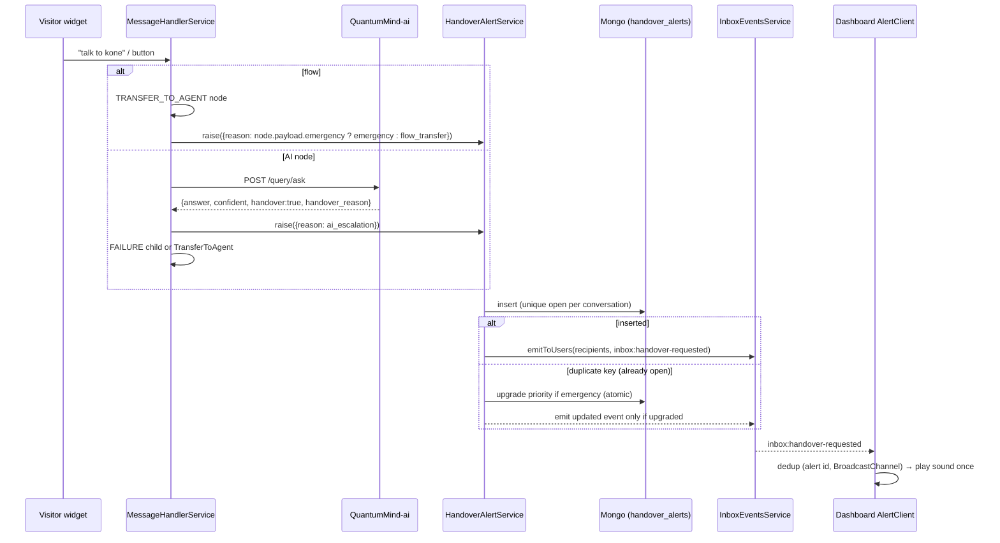
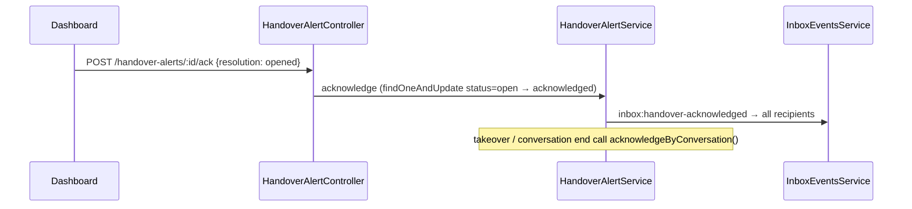

# Design Document: Agent Handover Alerts

## Overview

The Dashboard stops making a sound for ordinary chat traffic. It plays an alert only when the backend raises an explicit Handover_Alert, which happens at three points:

1. The flow reaches a TRANSFER_TO_AGENT node.
2. The visitor's message matches an Agent_Intent.
3. The AI returns `handover: true`.

Each Handover_Alert is persisted with a reason and a priority, and is sent once per Handover_Request as `inbox:handover-requested`. It stays visible until someone acknowledges it. A separate, softer Message_Notification covers visitor messages in conversations the signed-in agent already owns.

The design reuses what exists today:

- **Fan-out:** `InboxEventsService.broadcast`, which calls `findInboxRecipientIds` and then `RedisPropagatorService.propagateEvent`.
- **Persistence:** the provider-style module convention (`feedback` module).
- **Flow node payload:** `BotFlowNode.payload` is a free-form Object.

### Dependency status

The agent-handover-inbox spec is not implemented yet. This feature delivers only the minimal parts of it that it needs:

| Needed | Minimal delivery in this feature |
|---|---|
| Sender_Role on live inbox payloads | Derived in `WidgetInboxBridgeService` and the inbox mapper as `bot` when `sender === thread.bot`, `visitor` when `sender === visitorId` or `direction === 'inbound'`, otherwise `agent`. Added as an optional `senderRole` field on `InboxMessageView` and on the `message` socket payload. The full Req 1 of the dependency spec replaces this derivation later without changing the client. |
| Handover_Request | `HandoverAlertService.raise()` is the single entry point. It is called from `TransferToAgent`, from the AI escalation branch, and from the Agent_Intent hook when a bot has phrases configured. An "open" request is an alert with `status: 'open'`. |
| Ownership_State on the client | Taken from the existing `InboxThread.handledByAgent` and `assignedAgent.id`, plus the legacy active-chat list (`conversation.agent`). |

## Architecture





## Components and Interfaces

### Backend: `src/handover-alert/` (new module, `@Global`)

Files: `handover-alert.module.ts`, `handover-alert.provider.ts`, `constants.ts`, `entities/handover-alert.entity.ts`, `enums/`, `handover-alert.service.ts`, `handover-alert.controller.ts`, `handover-alert.listener.ts`.

**HandoverAlertService**

```ts
raise(input: {
  conversationId: string; botId: string; visitorId: string;
  visitorName?: string; threadId?: string;
  reason: AlertReason;              // flow_transfer | visitor_intent | ai_escalation | emergency
  handoverReason?: string;          // AI text, truncated to 200
  agentAssigned: boolean; assignedAgentId?: string;
  mode?: ModeEnum;
}): Promise<HandoverAlert | null>

acknowledge(alertId: string, user: AuthUser, resolution: 'opened' | 'taken_over'): Promise<HandoverAlert>
acknowledgeByConversation(conversationId: string, resolution: 'taken_over' | 'ended', userId?: string): Promise<void>
acknowledgeByThread(threadId: string, userId: string, resolution: 'opened' | 'taken_over'): Promise<void>
listOpenForUser(user: AuthUser): Promise<HandoverAlertView[]>
replayForAgentOnline(agentId: string): Promise<void>
```

`raise` works as follows:

1. If `mode === preview`, return null (Req 9.6).
2. Priority is `high` if the reason is `emergency`, otherwise `normal`.
3. Resolve recipients:
   - Agent assigned: `[assignedAgentId] ∪ orgAdmins(bot)`.
   - No agent assigned: `findInboxRecipientIds(botId)`, which already returns assigned agents ∪ org admins/managers in the bot's org, de-duplicated (Req 8.1, 8.3).
4. `insertOne` with `status: 'open'`, retried up to 3 times with backoff 1s/3s/6s, but only on non-duplicate errors (Req 1.7).
5. If the insert hits a duplicate key (E11000) on the partial unique index, an alert is already open:
   - If the new reason is `emergency`, run `findOneAndUpdate({conversationId, status:'open', priority:'normal'}, {$set:{priority:'high', reason:'emergency'}})`. If a document was modified, emit an updated event with `updated: true` (Req 2.4).
   - Otherwise, no-op (Req 1.3, 2.5).
6. On a successful insert, emit `inbox:handover-requested` to each recipient (Req 1.1). Emit failures are logged and never thrown (Req 1.6).

Acknowledgement always uses `findOneAndUpdate({_id, status:'open'}, {$set:{status:'acknowledged', ackBy, ackAt, resolution}})`. Only the first caller gets a document back and emits `inbox:handover-acknowledged` (Req 7.7). `acknowledge` first checks that `user._id ∈ alert.recipients` and that the user's org matches `alert.organizationId`. Otherwise it throws `ForbiddenException` (Req 7.8).

**Recipient helper.** Add `AgentService.findOrgAdminIds(botId)`, which runs the admin branch of `findInboxRecipientIds`.

**InboxEventsService additions.** Add `emitToUsers(userIds, event, data)`. It is the same per-user `propagateEvent` loop as `broadcast`, but takes an explicit recipient list, because alerts target a stored recipient set rather than "everyone on the bot".

**HandoverAlertController** (`@Controller('handover-alerts')`, `@Roles(...ORG_ROLES)`, since agents are recipients too)

- `GET /handover-alerts` lists open alerts for `@CurrentUser()`. The query is `{status:'open', recipients: user._id, organizationId: user.organizationId}`, sorted by `priority desc, createdAt asc` (Req 7.1, 7.6).
- `POST /handover-alerts/:id/ack` with body `{resolution: 'opened' | 'taken_over'}`.

**Hook points**

| Where | Change |
|---|---|
| `MessageHandlerService.TransferToAgent` (L1466) | Call `raise()` before `assignAgent` with reason `node.payload?.emergency === true ? 'emergency' : 'flow_transfer'`, `agentAssigned: false`. After assignment, call `handoverAlertService.setAssigned(alertId, agentId)` to record the assignee (recipients stay unchanged, so the admins and queue still see it). The no-agent branch keeps its current behaviour, but the alert now exists (fixes D5). |
| `MessageHandlerService.handleAiResponse` | After the AI call: if `aiResult?.handover === true`, call `raise({reason:'ai_escalation', handoverReason: truncate(200)})`, send the answer if it is non-empty after trimming, then go to `failureNode` if present, else `TransferToAgent(message, syntheticNode, userId)`. In the second case, a TRANSFER_TO_AGENT node reached later only upgrades priority (Req 3.3, 3.4, 3.7). The check uses a strict `=== true` (Req 3.5). |
| Agent_Intent (`handleMessage`, before node dispatch) | Only if `botSettings.agentIntents?.length`. On a whole-word match after normalisation, call `raise({reason:'visitor_intent'})` and route per dependency spec Req 8.3/8.4. If the bot has no phrases configured, there is no behaviour change. |
| `InboxService.markThreadRead` | Call `acknowledgeByThread(threadId, user._id, 'opened')`. The Dashboard already calls `/read` when a thread is selected, so no extra client call is needed for the inbox view. |
| `InboxService.setBotControl` with `takeover` | Call `acknowledgeByThread(threadId, user._id, 'taken_over')`. |
| `ConversationService.endConversation` and `endConversationByAgent` | Emit a new `conversation.ended` event `{conversationId}`. `HandoverAlertListener` acknowledges with `ended`. |
| Cron `markConversationExpiredAfter2Hours` | Before the `updateMany`, collect the ids of IN_PROGRESS conversations older than 2h that still have an open alert, then call `acknowledgeByConversation(id, 'ended')` for each. This keeps Req 7.5 true for silently expired conversations. |
| `SocketStateService.add` | On an agent's first socket, emit `agent.online {agentId}`. The listener calls `replayForAgentOnline`, which sends `inbox:handover-pending {alerts, playOnce: true}` to that agent only (Req 8.4, 8.5). |
| `WidgetInboxBridgeService.onChatPersisted` / `toMessageView` | Add the derived `senderRole`. Keep `direction` unchanged (Req 9.1, 9.2). |
| `MessageHandlerService.sendMessageToAgent` | Add `senderRole: 'visitor'` and `conversationId` to the `message` payload. |

**Thread id.** The widget bridge creates the thread lazily with `chatId = conversationId`. `raise()` therefore stores `conversationId` and looks up `threadId` through `channelThreadService.findByChat('widget', conversationId)` when available. If the thread doesn't exist yet, `threadId` is filled in on the first `onChatPersisted` (`setThreadIfMissing`). The Dashboard routes by `threadId` when it has one and falls back to `conversationId` for the legacy active-chat view.

### AI service: QuantumMind-ai

- **`app/schemas.py` `QueryResponse`:** add `handover: bool = False` and `handover_reason: Optional[str] = Field(None, max_length=200)`.
- **`app/services/answer_policy.py`:** add a deterministic pre-check, `detect_human_request(question)`. It uses a multilingual phrase list ("talk to (a|an)? (human|agent|person|someone|representative|staff)", "speak to", "real person", "customer service", Hindi/Marathi variants). It runs on the visitor's question, never on the answer. A match sets `handover=True` with `handover_reason="Visitor asked for a human"`.
- **`build_system_prompt`:** asks the model to end with a machine tag `<<HANDOVER: reason>>` only when it cannot help without a human action, such as booking, an account change or a complaint. `app/services/query.py` strips the tag from `answer` and sets the fields. If the tag is absent, `handover=False`. The tag is stripped before the answer is returned, so it never reaches the visitor.
- **`eval/datasets/suites.yaml`:** new suite `handover`. It contains at least 5 cases expecting `handover: true` and at least 5 expecting `false`. The false cases include "I can't connect you to an agent from here, but you can call…". `eval/runner.py` reports pass/fail on the `handover` field (Req 3.9).

### Dashboard: QuantumMind-ui

**`src/services/alerts/` (new, pure logic plus a thin browser adapter)**

- `alertPolicy.ts` contains pure functions, unit- and property-tested:
  - `shouldPlayHandover(event, prefs, playedIds)`
  - `shouldNotifyMessage(msg, ctx)`, where ctx is `{myUserId, ownership, openThreadId, tabFocused, atBottom, lastNotifiedAt, seenKeys, now}`
  - `messageKey(msg)`, which returns `id`, or `conversationId|time` when the id is missing
  - `sortAlerts`
- `soundPlayer.ts` holds preloaded `Audio` objects for `/sounds/handover.mp3`, `/sounds/emergency.mp3` and `/sounds/message-soft.mp3`. `play(kind)` catches the promise rejection. On `NotAllowedError` it sets the Redux flag `soundBlocked = true`, which shows a single "Enable sound" banner. A one-time `pointerdown`/`keydown` listener clears it. Rejected sounds are not queued (Req 6.3).
- `tabCoordinator.ts` uses `BroadcastChannel('jarcube-alerts')` plus a `localStorage` key `jarcube.alerts.played`, which holds the last 500 ids with timestamps. Before playing, a tab calls `claim(id)`, an atomic-enough compare on the localStorage entry followed by a broadcast. Only the tab that writes first plays. Every tab still renders the visual notification and the indicator (Req 6.4, 6.5). Without BroadcastChannel it falls back to localStorage only.
- `AlertClient.ts` subscribes to the socket events, applies the policy, dispatches to Redux and calls the player.

**AuthContext changes**

- Remove both `new Audio('/sound.mpeg')` blocks.
- Keep the `pushNotification` and dispatch calls only where the policy allows (Req 4.5–4.7).
- Wire `chatContext.onHandoverRequested()`, `onHandoverAcknowledged()` and `onHandoverPending()` (new methods in `socket.services.ts`) into AlertClient.
- On init and on `reconnect`, dispatch `fetchOpenAlerts()` (Req 7.1, 7.2).

**Redux slice `src/store/apps/alerts/index.ts`**

- State:
  - `alerts: Record<id, HandoverAlertView>`
  - `loadError`
  - `soundBlocked`
  - `prefs: {handoverSound: boolean, messageSound: boolean}`
- Thunks:
  - `fetchOpenAlerts`: retry 3 × 5s, 10s timeout (Req 7.9).
  - `ackAlert`
  - `saveSoundPrefs`: optimistic, reverted on failure with a toast (Req 6.8).
- `handleSoundToggle` and `enableSound` in the conversations slice become thin aliases to `prefs`, so the existing Mute button in `SidebarLeft.tsx` keeps working.

**UI**

- `components/alerts/HandoverAlertBell.tsx` sits in the app bar. It shows a badge count of distinct open alerts and a list ordered high first, then oldest first. Clicking an item navigates to the thread and calls `ackAlert(id, 'opened')`, which covers the legacy active-chat view that doesn't call `/inbox/.../read`.
- `components/alerts/HandoverToast.tsx` uses react-hot-toast. A `normal` alert has a 10s duration. A `high` alert has `duration: Infinity` and red styling. Both are dismissed programmatically on `inbox:handover-acknowledged` (Req 4.3, 4.4, 7.4).
- Sound settings live in the same bell popover as two switches.
- The flow builder's `bot-components/TransferChat.tsx` gets an "Emergency transfer (high-priority alert)" switch. It loads from `nodeDetails.payload.emergency ?? false` and saves `payload: {group, emergency}`. Today the save replaces the whole payload, which is why both keys must be sent (Req 2.8, 2.9).

**Sound_Preference persistence**

- Backend: add `notificationPrefs: {handoverSound: boolean = true, messageSound: boolean = true}` to the `Agent` entity. Return it from `getMe`.
- Add `PATCH /agent/me/notification-prefs` with `@Roles(...ALL_ROLES)` and a `class-validator` DTO.
- Cross-tab sync is done with the same BroadcastChannel message `{type:'prefs'}` (Req 6.1).

**Message_Notification (Req 5)**

`shouldNotifyMessage` returns `play` only when all of these hold:

- `senderRole === 'visitor'`.
- The thread or conversation is Agent_Owned by `myUserId`.
- The key hasn't been seen in the last 10s.
- It is not the case that the thread is open, the tab is focused and the view is at the bottom.
- `now - lastNotifiedAt[conv] >= 5000`.

When `prefs.messageSound` is false it returns `visualOnly`. Bot, agent, system and unknown roles get `none`.

For non-widget channels the same rule applies, using the thread's `handledByAgent` and `assignedAgent.id`. This implements Req 9.4 as the user accepted it. `atBottom` comes from a small `useChatViewport` store that `ThreadLog` and `active-chat/ChatLog` update on scroll.

## Data Models

```ts
// handover_alerts collection
{
  _id: ObjectId,
  organizationId: ObjectId,
  botId: ObjectId,
  conversationId: ObjectId,
  threadId?: ObjectId,
  visitorId: string,
  visitorName: string,            // fallback "Anonymous visitor"
  reason: 'flow_transfer' | 'visitor_intent' | 'ai_escalation' | 'emergency',
  handoverReason?: string,        // ≤200
  priority: 'normal' | 'high',
  recipients: ObjectId[],
  agentAssigned: boolean,
  assignedAgentId?: ObjectId,
  status: 'open' | 'acknowledged',
  resolution?: 'opened' | 'taken_over' | 'ended',
  ackBy?: ObjectId, ackAt?: Date,
  createdAt: Date, updatedAt: Date,
}
// Indexes
{ conversationId: 1 } unique, partialFilterExpression: { status: 'open' }   // once-per-request + concurrency
{ recipients: 1, status: 1, organizationId: 1, priority: -1, createdAt: 1 }  // list for user
{ threadId: 1, status: 1 }
```

Socket payloads:

```ts
// inbox:handover-requested
{ id, conversationId, threadId, botId, visitorName, reason, priority,
  createdAt, agentAssigned, updated?: boolean }
// inbox:handover-acknowledged
{ id, conversationId, threadId, resolution, ackBy }
// inbox:handover-pending (agent came online)
{ alerts: HandoverAlertView[], playOnce: true }
```

`BotPayload` gets a new optional field, `emergency?: boolean`. In the KONE flow JSON, `kone_agent_emg.payload` becomes `{ "emergency": true }`.

## Correctness Properties

1. **Once per request.** For any interleaving of N `raise()` calls on one conversation while an alert is open, exactly one document has `status: 'open'` and exactly one non-update `requested` event is emitted per recipient. The partial unique index enforces this, and it is tested with concurrent `Promise.all`.
2. **Priority is monotonic.** For any sequence of reasons, priority goes from `normal` to `high` at most once and never back. Reason becomes `emergency` only when an emergency trigger occurs.
3. **Text never triggers.** For any bot or AI answer text with `handover !== true`, `raise` is called zero times.
4. **Role silence.** For any message with `senderRole ∈ {bot, agent, system, undefined}`, `shouldNotifyMessage` returns `none`, and `shouldPlayHandover` is never consulted for `inbox:message`.
5. **One tab plays.** For any set of tabs that receive the same id in any order, exactly one `claim(id)` returns true.
6. **First acknowledgement wins.** For any set of concurrent acknowledgements, exactly one succeeds and later ones are no-ops that emit no event.
7. **Recipient scoping.** `listOpenForUser(u)` returns only alerts where `u ∈ recipients`, `organizationId === u.organizationId` and `status === 'open'`.
8. **Throttle.** For any arrival sequence of visitor messages on one owned conversation, any two consecutive Message_Notification sounds are at least 5s apart.

## Error Handling

- **Alert persistence fails:** `raise` retries 3 times, then logs at error level and returns null. The flow continues unchanged and the visitor sees no extra message (Req 1.7, 9.7).
- **Emit fails:** logged only. The alert stays open and is returned by `GET /handover-alerts` (Req 1.6).
- **AI response is missing the new fields:** handled as `handover: false`, so the old backend and new AI (or the reverse) stay compatible.
- **Acknowledgement by a non-recipient:** returns 403 and nothing changes.
- **Client `play()` rejection:** caught and shown as the banner. No unhandled promise rejection.
- **Pref save fails:** the toggle reverts and an error toast is shown.

## Testing Strategy

- **Backend (Jest, already configured):** `handover-alert.service.spec.ts` uses mongodb-memory-server if it is available, otherwise a mocked model with simulated E11000. It covers properties 1, 2, 6 and 7, recipient resolution with and without an assigned agent, preview mode, retry on persistence failure, and the hook tests for `TransferToAgent` and `handleAiResponse` (handover true/false/non-boolean, with and without a FAILURE child). Add `fast-check` as a pinned dev dependency for properties 1, 2 and 6.
- **UI:** there is no test runner today. Add `vitest` and `fast-check`, pinned, with a `test` script. Test `alertPolicy.ts` and `tabCoordinator.ts`, the latter with a mocked BroadcastChannel and localStorage, for properties 4, 5 and 8. Components are verified manually.
- **AI (pytest):** unit tests for `detect_human_request` and tag stripping, plus the new `handover` eval suite run with `eval/runner.py --dataset handover`.
- **Manual end-to-end with the KONE flow:**
  - Emergency gives the high sound and a sticky toast.
  - "Talk to KONE" gives the normal sound.
  - Ordinary menu clicks and AI answers play no sound.
  - Two tabs play one sound.
  - After a reload, the bell shows unacknowledged alerts silently.
  - Opening a thread clears the alert everywhere.
