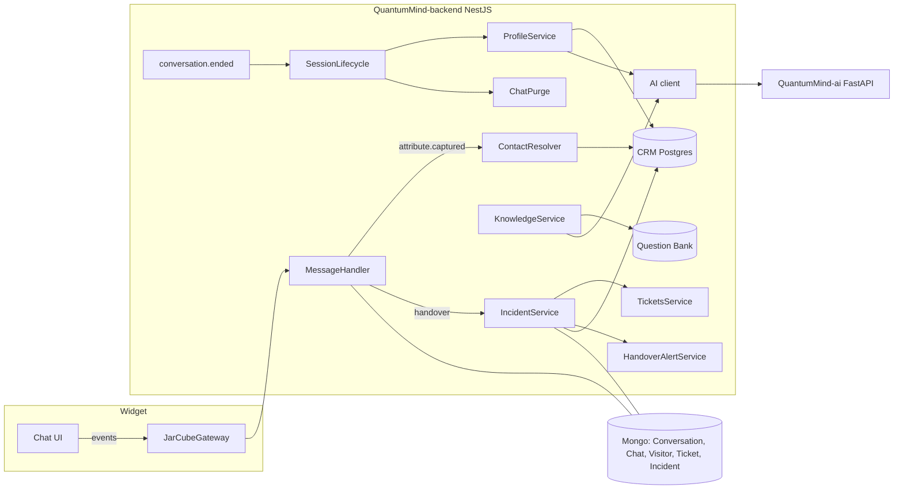
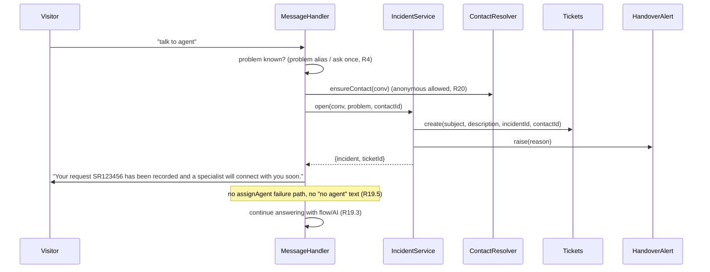
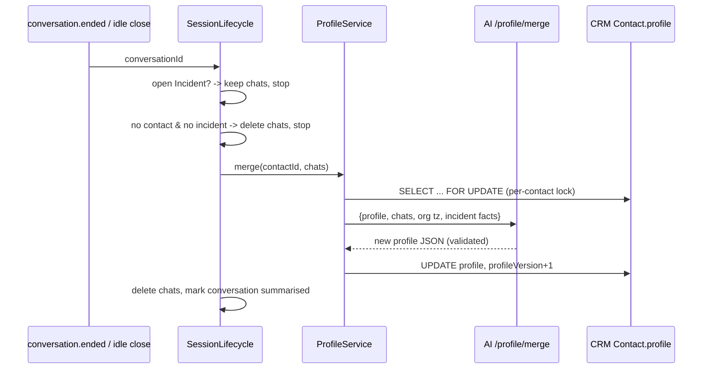

# Design Document: CRM, Incident Handover and Visitor Profile

## Overview

This design turns a visitor's request for help into a tracked Incident linked to a CRM contact. It replaces stored chat transcripts with one rolling AI-maintained Visitor_Profile per contact and feeds agent resolutions back into the bot's knowledge. It also fixes these KONE-flow defects:

- tickets raised blind
- the instant "no agent available" message
- empty history for agents
- the bot restarting the menu after a final answer

The authority is `requirements.md` in this folder. Requirements 16 to 22 and Decisions D1 to D10 win over earlier criteria, as listed under "Withdrawn or replaced". This document refers to requirements as `R<n>.<criterion>`.

**Out of scope for this release**

- Separate databases per organization (D11): all orgs share one CRM Postgres, isolated by `organizationId`.

- WhatsApp and other channels (D7).
- Identity passed in by a host website (deferred; needs its own plan).
- Any dependency on a customer project such as myKONE (D10).
- Agent queue positions, wait timeouts and business hours shown to visitors (D2).

**Progress tracking.** Implementation is phased so that each phase ships independently and leaves the system working. `tasks.md` is the single tracker. After each session, tick tasks there and update its "Session log" section.

---

## Current state (verified in code)

| Area | Fact | Location |
|---|---|---|
| Ticket | Mongo `Ticket`. `ticketId` = `generateId("SR",6)`. Status `OPEN, CLOSED, PENDING, DEFERRED` (no RESOLVED; "resolved" = `markAsResolved` → CLOSED + RESOLVED activity). `description` is never set from chat. | `tickets/entities/ticket.entity.ts`, `tickets.service.ts` L47-139 |
| Ticket from flow | `handleCreateTicket` passes no description. The confirmation shows the Mongo `_id`. | `message-handler.service.ts` (MH) L1345-1373 |
| Handover | `TransferToAgent` raises the alert, then `assignAgent` (ONLINE only). With no agent it sends a hard-coded "No agent… Enter Start" message and goes to FAILURE. `new-visitor` is sent with `chats: []`. | MH L1570-1672 |
| Terminal nodes | SUCCESS, FAILURE and TIMEOUT continue to `next`, else `restOnTerminalNode` (AI keeps answering). `handleCloseChat` sends "To start again type start" and emits `end.conversation`. | MH L1481-1568, L1882-1906 |
| Conversation end | `endConversation` sets COMPLETED and emits `conversation.ended`. A cron every 2 h marks old IN_PROGRESS conversations EXPIRED and emits `conversation.ended`. | `conversation.service.ts` L564-590, L1011-1033 |
| Widget identity | `POST /widget/visitor` creates a new Visitor (anonymous dedupe never matches) and a new Conversation on every load. The token lives 1 h in memory only. The gateway sends `"start"` on every connect. | `widget.service.ts` L129-196, `jarcube.gateway.ts` L232-242, widget `store/bot/bot.ts` |
| Attributes | `SocketState.attributes`, in memory only. Written by `captureUserInput`, `handleQuestion`, payload SET_ATTRIBUTES and `routeTemplateResume`. | MH L1166-1188, L1770, L1857, L2325 |
| CRM | Postgres via Prisma (`CRM_DATABASE_URL`). `Contact` has no Json field, no phone index and no anonymous flag. `RecordSource` has no CHAT value. `ContactFact` (PROPOSED/APPLIED/DISMISSED) exists. `CrmDatabaseModule` is `@Global`. Sub-modules export `ContactsService`, `ActivitiesService` and `FactsService`. `forOrg(orgId)` returns the one shared client; tenant isolation is by `organizationId` (D11). | `prisma/schema.prisma`, `src/crm/**` |
| Ownership | `setBotControl` reads, then makes an unconditional `assignToAgent` write, so two takeovers can race. Org admins bypass the check silently. `sendMessage` has no owner check. No typing handler exists in the gateway. | `inbox.service.ts` L612-686, `channel-thread.service.ts` L371-393 |
| Question Bank | `status` is `approved` or `under_review`. `addedBy`/`approvedBy` are org-scoped and there is no bot field. `findAnswerFromQuestionBank` is fail-closed by org. | `questions/**`, MH L2563-2596 |
| AI service | `/query/ask`, `/generate/summary` (template submissions only), `/ingest/text`, `DELETE /ingest/{client}/{source}`. Provider via `get_llm_provider().generate(messages)`. | `QuantumMind-ai/app/**`, backend `ai/ai.service.ts` |
| Mail | Only a transcript template; there is no generic send method. | `mails/mails.service.ts` |
| Org | No country or time-zone field. | `organization/entities/organization.entity.ts` |

---

## Architecture



### Key flows

**Handover (Requirements 4, 19, 20)**



**Session end and profile merge (Requirement 18)**



---

## Components and Interfaces

### Backend (QuantumMind-backend)

#### 1. `IncidentModule` (new, `src/incident/`, `@Global`)

The Mongo `Incident` entity lives next to `Conversation`. Conversations already live in Mongo, and keeping the Incident there gives atomic `findOneAndUpdate` with the conversation's ids.

```ts
Incident {
  _id, organizationId, botId, conversationId, threadId?, visitorId,
  crmContactId?: string,          // Postgres cuid, no FK
  problem: string, problemFlags: ('short'|'truncated'|'none')[],
  status: 'waiting'|'agent_active'|'follow_up'|'resolved'|'closed',
  outcome?: 'resolved_by_agent'|'resolved_by_bot'|'follow_up_ticket'|'abandoned'|'closed_unresolved',
  ticketId?: ObjectId, ticketRef?: string,       // ticket._id + 'SR……'
  handoverAlertId?: string,
  agentId?: string, acceptedAt?, resolvedAt?, closedAt?, endCause?,
  resolutionNote?: string,
  ownershipLog: { at, actor, from?, to?, kind:'takeover'|'release'|'override' }[],
  summary?: { problem, resolution, ai: boolean, editedBy?, editedAt?, original? },
  knowledge?: { questionId?, status:'created'|'failed', error? },
  createdAt, updatedAt
}
// Index: unique partial { conversationId } where status in [waiting, agent_active, follow_up]
```

`IncidentService` methods:

- `openForHandover(conv, {problem, flags, reason}) -> {incident, ticket}`. Idempotent per open incident (unique index). It creates the Ticket and the Incident together (Ticket first, then Incident; on Incident failure the ticket is linked by a retry job). It calls `HandoverAlertService.raise`.
- `accept(incidentId, agent)` → `agent_active` (conditional on status).
- `resolve(incidentId, agent, note)` (R10.1, R10.6) and `closeOnConversationEnd(convId, cause)` (R10.4). Both use a conditional `findOneAndUpdate({status: {$nin: [resolved, closed]}})`, which gives single closure (R10.7).
- `onTicketResolved(ticketId)` (R1.7), listening to a new `ticket.resolved` event emitted by `markAsResolved`.
- `listForContact(orgId, contactId, page)` (R9.4).
- It emits `incident.opened`, `incident.updated` and `incident.closed`.

#### 2. `ContactResolver` (new, `src/crm-bridge/contact-resolver.service.ts`)

This service bridges Mongo chat data to the CRM. It uses `CrmPrismaService.forOrg` directly, which avoids HTTP-shaped DTO errors.

- **Trigger.** MH emits `attribute.captured {userId, conversationId, botId, keys}` after each attributes merge, at the four write sites listed in Current state. A free-text extractor also runs (R16.5): a regex for email and phone plus an optional AI extraction call, which is cheap and only runs when the text contains "@" or 7 or more digits.
- **Mapping.** `BotSetting.contactMapping ?? {name:'contact_name', email:'contact_email', phone:'contact_phone'}` (R2.9).
- **Validation.** `isValidEmail` (R2.1) and `normalisePhone` (digits plus a leading "+", 7 to 15 digits).
- **Matching** (R2, R17):
  1. Email match, then phone match (non-archived, org-scoped; earliest `createdAt` wins, R2.10).
  2. If both identifiers are given and they hit different contacts, link to the email match and record a `MERGE_SUGGESTION` Activity on both contacts (R17.4).
  3. If one identifier matches and the other conflicts, return `{conflict: {field, existingMasked, newValue}}`. MH then asks the visitor using `IdentityPrompt` (below) (R17.2).
  4. Otherwise, create the contact (R2.3 and R2.5 naming) or fill empty fields only (R2.4). A field edited by a human is never overwritten; a `ContactFact` PROPOSED is written instead (R17.6). "Human-edited" means `contact.updatedById` is not the system user. A `fieldSources Json` column records which writer set each field.
- **Concurrency.** A Postgres advisory lock is taken on `hash(orgId|identifier)` for the match-or-create critical section, and a partial unique index covers `(organizationId, lower(email)) WHERE archivedAt IS NULL AND email IS NOT NULL`. This gives the dedupe property (R2.7).
- **Linking** (R3). The CRM id is stored on `Visitor.crmContactId` and `Conversation.crmContactId`, and the visitor id is pushed into `Contact.visitorIds text[]`. One `Activity{type: NOTE, meta.kind: 'chat_linked'}` is written per conversation, guarded by `meta.conversationId` uniqueness (R3.2).
- **Failure** (R2.8). A failed operation is written to a Mongo `crm_outbox` collection `{op, payload, attempts, nextAt}` and drained by a 1-minute cron at 1, 3 and 10 minutes. The chat flow is never awaited on a CRM failure.
- **Anonymous** (R20). `ensureContact(conv, {anonymousOk: true})` creates `firstName: 'Anonymous visitor', lastName: <6-character id>, isAnonymous: true, source: CHAT`. An upgrade fills the same row. A merge moves the Activities, rewrites `crmContactId` on Mongo Visitors, Conversations, Incidents and Tickets, merges the Visitor_Profile entries by date, then archives the anonymous row.

#### 3. `IdentityPrompt` and "ask once" (R16, R17)

This is a small state machine stored in `SocketState.pendingIdentity` and persisted on the Conversation as `pendingIdentity` so that it survives a reload.

- **Before a QUESTIONS, USER_INPUT or OPEN_TEMPLATE node asks for a Contact_Details alias:** MH calls `ContactResolver.known(conv)`, which reads the Conversation attributes, then `Visitor`, then the CRM contact.
  - If all asked fields are known, it skips the node and sends the confirm message with the buttons "Yes" and "Update details" (R16.1, R16.2).
  - If some are known, it pre-fills those aliases and asks only the rest.
- **Conflict prompt:** a buttons message with "Keep existing", "Use new" and "Keep both" (R17.2). It times out after 2 visitor turns, at which point it writes a `ContactFact` PROPOSED (R17.5). "Keep both" stores the new value in `Contact.altIdentifiers Json` (R17.3).

#### 4. Problem description gate (R4)

This logic lives in `MessageHandlerService.ensureProblemDescription(userId)`, which runs before `IncidentService.openForHandover`.

- It uses the problem alias (`BotSetting.problemAlias ?? 'contact_topic'`) when that attribute is non-empty (R4.3).
- Otherwise it sends `BotSetting.problemQuestion` and sets `SocketState.awaitingProblem = {attempt, askedAt}`.
- The next visitor text is consumed as the answer, not routed into the flow. A second short answer is accepted and marked short (R4.4, R4.5). An answer over 1000 characters is truncated (R4.6). With no answer within 10 minutes, the cron drops the pending handover (R4.7).

#### 5. `TransferToAgent` rewrite (R19)

The new sequence is:

1. Ensure the problem description (gate above).
2. `ensureContact` (anonymous allowed).
3. `IncidentService.openForHandover`.
4. Send `BotSetting.handoverMessage` with `{{ticketId}}` (default: "Thanks. Your request {{ticketId}} has been recorded and a specialist will connect with you soon.").
5. Mark the conversation `incidentOpen`.
6. Try `assignAgent(botId)` silently:
   - If an online, eligible agent exists, offer the alert as today and wait for the agent to take over.
   - Otherwise, do nothing visible.
7. Take the SUCCESS branch.

The FAILURE branch is taken only when step 3 throws (R19.5).

While the incident is open and not Agent_Owned, the flow and the AI continue as normal (R19.3). Once Agent_Owned, the existing suppression from agent-handover-inbox applies.

The emergency path: the node's `payload.emergency` keeps the high-priority alert from the alerts spec. The conversation itself is regular flow text and clarifying questions (D1).

#### 6. Ownership (R7, R8)

- `ChannelThreadService.claim(threadId, userId)` performs `findOneAndUpdate({_id, $or: [{assignedAgent: null}, {assignedAgent: userId}]}, {$set: {...}})`. A null result means a 409 carrying the owner's name (R7.1). Both `takeover` and incident `accept` use it.
- `InboxService.override(user, threadId, targetAgentId?)`: org admin only, writes to `Incident.ownershipLog`, and notifies the previous owner over the socket (`inbox:ownership-overridden`) (R7.3). A plain takeover by an admin no longer bypasses the check (R7.4).
- `InboxService.sendMessage` and the gateway's `chat-message-from-agent` both reject a non-owner with `not_thread_owner` (R7.2).
- Release is owner only (R7.6). Membership checks are reused from `requireThread` and `canControlVisitor` (R7.8).
- Typing:
  - The gateway gains `agent-typing {threadId}`, throttled per 3 seconds, which fans out `inbox:agent-typing {threadId, agentId, name}` to thread recipients and `typing` to the visitor when `typingIndicator` is on (R8.6 to R8.8).
  - The client clears the indicator 5 seconds after the last signal.
- UI (`ThreadContent.tsx`, legacy `ChatContent`):
  - Header: "<name> is handling this chat" / "You are handling this chat".
  - Buttons are shown according to the ownership matrix.
  - The composer uses `disabledReason`.
  - The Override confirmation dialog is shown to admins only.
  - The view refreshes on `inbox:thread-updated` (R8.1 to R8.5, R8.9).

#### 7. Full history and visitor continuity (R9)

- **Server.** `GET /incidents/:id/context` returns the conversation's chats from the server (sorted ascending, with the sender role) plus `contact.profile` and earlier incidents. Both agent views call it on open (R9.1, R9.4).
- **`new-visitor` payload.** It gains `conversationId` and `threadId`. `pushToActiveConversations` triggers `loadOldChats` automatically (R9.2).
- **Widget continuity** (R9.3, R9.11):
  - The widget persists `{visitorId, conversationId, botId}` in `localStorage['jarcube.session.<botId>']`.
  - `POST /widget/visitor` accepts `resume: {visitorId, conversationId}`.
  - If the visitor belongs to the bot and the conversation is IN_PROGRESS and not ended, `WidgetService` returns a fresh token for the same ids and rebuilds socket state from the conversation (`currentNode` from the persisted `conversation.flowPosition`; this is a new field written on every node change, debounced).
  - Otherwise it creates a new conversation for the same visitor.
- **Gateway.** `handleConnection` skips `"start"` when `socketState.resumed === true` or the conversation already has chats (R9.3, R14.7).

#### 8. `SessionLifecycle` and Chat purge (R18, R13 replaced)

This listens to `conversation.ended` and to the idle-close event of the Closure_Prompt. The rules:

- If an incident is open, keep the chats and return (R18.6). When `incident.closed` fires, re-run the rule.
- If there is no `crmContactId` and no incident, delete the Chat rows and mark the conversation `transcriptState: 'purged'` (R18.7).
- Otherwise, run `ProfileService.merge(contactId, conversationId)`. On success, delete the chats and mark `transcriptState: 'summarised'` (R18.5). On failure, keep the chats and set `transcriptState: 'pending_merge'`. A daily cron retries `pending_merge` (R18.10).
- Deletion runs in a Mongo transaction where available. Otherwise it is a single `deleteMany({conversationId})` followed by the flag update; a deletion with no flag is detected and re-run by the cron.
- Conversation counters (`messageCount`, `startedAt`, `endedAt`) are written before deletion so that reports stay correct.

#### 9. `ProfileService` (R18, Visitor_Profile)

- **Storage.** `Contact.profile Json` (nullable) and `Contact.profileVersion Int @default(0)` on the CRM `Contact` (D9: one document, no separate table).
- **Schema** (validated with zod on both write and read):

```jsonc
{
  "v": 1,
  "facts": {
    "interests": ["…"], "products": ["…"], "preferences": ["…"],
    "openIssues": [{ "text": "…", "since": "2026-10-07", "incidentId": "…", "ticketRef": "SR…" }],
    "language": "en"
  },
  "adminOverrides": { "facts.interests": ["…"] },        // R18.12 — merge must keep these
  "entries": [                                           // newest first
    { "at": "2026-10-07T21:12:00+05:30", "tz": "Asia/Kolkata", "bot": "…", "channel": "widget",
      "summary": "…≤300 chars", "tags": ["tender"], "outcome": "follow_up_ticket",
      "incidentId": "…", "ticketRef": "SR…", "agent": "…", "problem": "…", "resolution": "…" }
  ],
  "earlier": { "from": "…", "to": "…", "summary": "…", "incidentRefs": ["SR…"] }  // compression bucket
}
```

- **Merge.** `ProfileService.merge(contactId, conversationId)`:
  1. In a Prisma `$transaction`, take `SELECT … FOR UPDATE` on the contact row, which serialises concurrent merges (R18.11).
  2. Load the chats with `senderRole`, the incident facts, and the org time zone.
  3. Call the AI service `POST /profile/merge`.
  4. Validate the result and enforce: `entries` grow by exactly 1, all earlier `incidentId`s and `ticketRef`s are preserved, `adminOverrides` are untouched, and size is at most 8000 characters. If the size check fails, the AI is asked again with `compress: true` (R18.9).
  5. Write the profile and `profileVersion+1`.
  6. Write one `Activity{type: NOTE, meta.kind: 'session_summary', meta.at, meta.conversationId}` with the entry summary, so the existing ActivityTimeline shows it.
- **Retries.** 30, 60 and 120 seconds, with a 60-second timeout (R11.6). After the last failure, a deterministic fallback entry is built from the incident fields or the conversation stats (R11.7), so that chats can still be released. A fallback entry is marked `ai: false`.
- **Use.** `MessageHandler` passes `profile` (facts plus the 5 newest entries) as `visitor_profile` into `/query/ask` and the AI node `chat_history` system context (R18.8). The Agent_View shows it.

#### 10. `KnowledgeService` (R21, replaces R12 approval)

- **Trigger.** `incident.closed` with `outcome: resolved_by_agent` and a resolution note.
- **Generate.** `POST /knowledge/candidate {problem, resolution, company}` returns `{question, answer}`, with personal data removed and the length rules enforced. The result is rejected (and `incident.knowledge.status = failed` recorded) if it still matches the email, phone, contact-name or ticket regexes (R12.2 and R12.9 rules kept).
- **Dedupe** (R21.3). `POST /knowledge/similar {client_id, text}` returns the best similarity against existing `incident:*` sources. At 0.9 or above, the existing Question Bank entry is updated with `sources[] += incidentId`, and the knowledge-base source is re-ingested.
- **Write.** Question Bank `{question, answers:[answer], status: approved, addedBy: agentId, approvedBy: SYSTEM_USER_ID, source: {kind: 'incident', incidentIds}, organizationId}`. The self-approval check is skipped only when `approvedBy === SYSTEM_USER_ID` (R21.1).
- **Ingest.** `aiService.addKnowledge(client_id = botId or the clientId setting, text = Q + A, source = 'incident:<id>')` (R21.2).
- **Edit or delete.** These hook into the `QuestionsService` update and delete paths and call `removeKnowledge` and `addKnowledge` (R21.4).
- **Metric** (R21.5). `GET /reports/agent-share?bot&month` returns `count(conversations with incident) / count(conversations)`, shown on the bot dashboard card with a target line at 1%.

#### 11. Ticket changes (R1)

- `CreateTicketDto` gains optional fields `incident`, `crmContactId` and `source: 'chat'`. `Ticket` gains `incident?` and `crmContactId?`. Both are additive (R15.4).
- `handleCreateTicket` builds the description (R1.1, R1.6), reuses the open incident's ticket (R1.8), sends `ticketId` and not `_id` (R1.3), and takes the failure path on error (R1.9).
- `markAsResolved` emits `ticket.resolved` (R1.7).
- The Service Request detail view shows a CRM contact link and the Incident status, or "Not linked" (R1.4).

#### 12. Closure prompt and Ended_State (R14)

- **When it is sent.** `TerminalOutcome` is detected when, with no `next`, the flow reaches a SUCCESS, FAILURE or TIMEOUT node, or a node with `payload.terminal === true` (flow-builder toggle), or a CLOSE_CHAT node, or right after `openForHandover` when the handover node's SUCCESS has no `next`. At that point MH sends the `closurePrompt` buttons and sets `SocketState.awaitingClosure = {sentAt}`, persisted on the Conversation.
- **This replaces `restOnTerminalNode`'s silent AI parking** for those cases only. Existing flows that wire `next` are unchanged (R15.2).
- **Responses:**
  - "Yes, resolved": send the closing message, call `endConversation`, emit `conversation-ended` to the widget, and resolve the incident by the bot if it was open (R10.3).
  - "I need something else" or free text: go to `startNode`, and process the free text as input (R14.3, R14.10).
  - "Start again" or "start", "reset", "restart": restart in the same conversation (R14.4).
- **Idle close.** A 1-minute cron finds `awaitingClosure.sentAt + idle < now` and closes the conversation (R14.5). The idle time comes from `BotSetting.closureIdleMinutes` (default 10, range 1 to 60).
- **While Agent_Owned,** no prompt and no countdown run (R14.11).
- **Widget.**
  - It handles the `conversation-ended` socket event by setting `ended: true` in Redux and in `localStorage['jarcube.session.<botId>'].ended`.
  - Input and buttons are disabled.
  - A notice and a "Start new chat" button are shown. The button calls `POST /widget/visitor {resume: {visitorId}, newConversation: true}` (R14.6, R14.9).
  - On reload, `ended` shows the Ended_State and no socket connect happens (R14.7).
- **`handleCloseChat`** drops the "To start again type start" line and sends the closing message plus the Ended_State event.
- **KONE flow JSON.** `kone_r_agent_busy → kone_goto_menu` is replaced by a terminal node (R14.8). This is a data change in `docs/koneTrainingData/...`, not product code (D10).

#### 13. Org time zone (R22)

- `Organization.country?: string` (ISO-3166 alpha-2) and `Organization.timeZone?: string` (IANA).
- A country-to-default-zone table lives in `src/common/time/country-zones.ts`, covering the primary zone per country (the first zone in IANA `zone1970.tab`). Admins can override it.
- `formatInOrgTz(date, org)` uses `Intl.DateTimeFormat` with `timeZone` and `timeZoneName: 'short'`, and defaults to UTC.
- Org settings UI: a country select and a time-zone select. The time zone is pre-filled from the country.

#### 14. Mail (R19.4, follow-up)

Add `MailsService.sendTemplate(to, subject, template, context)` and a `ticket-ack.hbs` template (ticketRef, problem, org name, date in the org time zone). The sender address is `ORG_MAIL_FROM`, falling back to the existing default. Agents can reply by email from the incident view: `POST /incidents/:id/email-reply`, which sends the email and records an Activity.

### AI service (QuantumMind-ai)

Every new endpoint uses `get_llm_provider()` with a JSON-only system prompt, strict pydantic response models and the existing tracing spans.

| Endpoint | Request | Response | Notes |
|---|---|---|---|
| `POST /profile/merge` | `{profile?: VisitorProfile, chats: [{role, text, at}], incident?: {...}, org_tz, bot, channel, compress?: bool}` | `{profile: VisitorProfile, tokens_used, provider, model}` | The system prompt specifies the schema, the rule to append exactly 1 entry, the rule to keep every ref, the rule to keep adminOverrides, the 8000-character cap, and the compression rule. Input chats are pre-masked by the backend. |
| `POST /knowledge/candidate` | `{problem, resolution, company?}` | `{question, answer}` | Generalised, with no PII; lengths 10 to 500 and 10 to 2000. |
| `POST /knowledge/similar` | `{client_id, text, source_prefix:"incident:"}` | `{best: {source, score}?}` | Vector search restricted to that source prefix. |
| `POST /extract/contact` | `{text}` | `{name?, email?, phone?}` | Used only when regexes find a candidate (R16.5). |
| `/query/ask` (existing) | adds optional `visitor_profile` | unchanged | Profile facts plus the 5 newest entries are injected into the system prompt as "What we know about this visitor". |

The PII masker (R11.5) lives in the backend (`src/common/pii/mask.ts`). It masks email, phone and secure QUESTION values before every AI call, and the profile stores only masked text. Raw identifiers live only in the CRM Contact columns.

### Dashboard (QuantumMind-ui)

- **Agent views** (`views/apps/inbox/ThreadContent.tsx`, `views/apps/active-chat/ChatContent.tsx`):
  - an ownership header, a button matrix, a disabled composer and the Override dialog
  - an "is replying…" indicator
  - a Visitor_Profile panel, an earlier-incidents list, an "Add details" form for anonymous contacts, and a "Resolve incident" dialog with a note (10 to 2000 characters)
  - "Email reply" when the visitor is offline
- **CRM contact page** (`pages/crm/contacts/[contactId]`):
  - a Visitor_Profile card that is editable by admins, where edits write to `adminOverrides` or delete entries (R18.12)
  - linked conversations, incidents and tickets (R3.3)
  - an Anonymous badge
- **Service Request detail:** a contact link and the incident status.
- **Question Bank list:** a "Learned from incident" label, a link to the incident, and edit or delete actions.
- **Bot settings:**
  - contactMapping, problemAlias, problemQuestion, handoverMessage, closurePrompt texts, closureIdleMinutes
  - a Terminal toggle on flow nodes
- **Org settings:** country and time zone.
- **Reports:** the agent-share card.

### Widget (QuantumMind-widget)

- Persist the session per bot, resume on load, and stop the auto "start" when resuming.
- Handle `conversation-ended` by showing the Ended_State with a "Start new chat" button.
- Render the Closure_Prompt and identity-conflict buttons. These are the existing buttons message type, so no new component is needed.
- Show the typing indicator on the `typing` event from an agent.

---

## Data Models

**CRM Postgres (Prisma migration `crm_incident_profile`)**

```prisma
enum RecordSource { MANUAL IMPORT EMAIL CALENDAR TRACKING CHAT }   // + CHAT
model Contact {
  // + 
  isAnonymous    Boolean  @default(false)
  phoneNormalized String?
  visitorIds     String[] @default([])
  altIdentifiers Json?
  fieldSources   Json?
  profile        Json?
  profileVersion Int      @default(0)
  @@index([organizationId, phoneNormalized])
}
// raw SQL in migration:
// CREATE UNIQUE INDEX contact_org_email_active ON contact ("organizationId", lower(email))
//   WHERE "archivedAt" IS NULL AND email IS NOT NULL;
```

Before the unique index is created, the migration runs a de-duplication check. It lists existing duplicates and aborts with instructions if any are found, so production data is never auto-merged.

**Mongo**

| Collection | Change |
|---|---|
| `incidents` | New. |
| `crm_outbox` | New. |
| `Conversation` | `+ crmContactId, flowPosition, pendingIdentity, awaitingClosure, incidentOpen, transcriptState, messageCount, endedAt, endCause` |
| `Visitor` | `+ crmContactId` |
| `Ticket` | `+ incident, crmContactId, source` |
| `Question` | `+ source {kind, incidentIds}` |
| `BotSetting` | `+ contactMapping, problemAlias, problemQuestion, handoverMessage, closurePromptText, closingMessage, closureIdleMinutes` |
| `Organization` | `+ country, timeZone` |
| Flow node payload | `+ terminal?: boolean` |

All new fields are optional, so existing documents stay valid with no backfill (R15.4).

---

## Correctness Properties

### Property 1: Contact dedupe

For any interleaving of captures of the same email or phone in one org, exactly one non-archived contact remains. Test with concurrent `resolve()` calls against a test Postgres, or with an advisory-lock simulation.

**Validates: Requirements 2.7**

### Property 2: Fill-empty-only

For any existing contact and any capture, the non-empty, human-sourced fields are unchanged after `resolve()`.

**Validates: Requirements 2.4, 17.6**

### Property 3: One open incident

For any concurrent handover triggers on one conversation, at most one incident is open and at most one ticket exists for it (R6.9 carried into R19).

**Validates: Requirements 4.8**

### Property 4: Single closure

For any sequence of resolve, close, and conversation-end events, the incident ends with exactly one terminal status, and at most one closing Activity exists.

**Validates: Requirements 10.7**

### Property 5: Single owner

For any set of concurrent takeover requests, exactly one claim succeeds, and only the owner's replies are persisted.

**Validates: Requirements 7.1**

### Property 6: Profile monotonicity

For any sequence of merges, including concurrent ones, every incidentId and ticketRef ever merged remains present (in an entry or in `earlier`), the entry count grows by exactly one per merge (before compression), and the size is at most 8000 characters.

**Validates: Requirements 18.2, 18.9, 18.11**

### Property 7: No unmerged deletion

For any failure injected into the merge, the chats of that conversation are not deleted.

**Validates: Requirements 18.10**

### Property 8: Visitor side and no-restart

After a Closure_Prompt, no main-menu or AI message is sent until a visitor response, and a reconnect in the Ended_State sends no "start".

**Validates: Requirements 14.1, 14.7**

### Property 9: PII-free outputs

For any transcript containing emails, phones or secure values, the masked AI input and the learned Q&A contain none of them.

**Validates: Requirements 11.5, 12.2**


---

## Error handling

- Visitor-facing paths never wait on the CRM or the AI. Failures go to `crm_outbox` or to retry crons, and the chat continues.
- Incident creation failure takes the FAILURE branch with one "could not record" message (R1.9, R19.5).
- AI merge or summary failures follow the retry schedule, then a deterministic fallback. Chats are kept until a profile is written.
- Ownership conflicts return 409 with the owner's name. The UI keeps the unsent text.
- Migration aborts on existing duplicate emails rather than merging silently.

## Testing strategy

- **Backend (Jest, fast-check already installed):**
  - unit and property tests for ContactResolver (with an in-memory Prisma fake and lock simulation), IncidentService (a fake model with the unique-open index), ProfileService merge validation, ownership `claim`, the closure state machine, the problem gate, and the PII masker
  - an integration replay of the KONE flow (extending `webhook-failure.spec.ts`) covering handover, ticket, closure and the absence of a menu restart
- **AI (pytest, run in the Docker image):**
  - schema validation for `/profile/merge`, `/knowledge/candidate` and `/extract/contact` using a stub provider
  - prompt-contract tests (append exactly 1 entry, keep refs)
  - eval cases added for profile merge quality
- **UI (vitest):**
  - the ownership button matrix as a pure function
  - profile rendering helpers
- **Widget:**
  - session persistence and resume logic as a pure function
  - the Ended_State reducer
- **Manual:** a two-agent takeover race, reload during a chat, an anonymous handover followed by adding details, and a returning visitor whose profile is used by the AI.

## Rollout and migration

1. **Feature flags** per org, in `BotSetting.features`: `crmCapture`, `incidentHandover`, `profileSummaries`, `closurePrompt`, `autoLearn`. Each phase ships behind its flag, default off, then KONE is turned on.
2. **Chat deletion (`profileSummaries`) is irreversible.** Enable it only after the profile merge has been validated on staging. Add a dry-run mode, `transcriptState: 'would_purge'`, for the first week.
3. **Prisma migration.** Run the duplicate check first, then `prisma migrate deploy`.
4. **Existing open conversations** are untouched. New behaviour applies to conversations started after a flag is enabled.

## Phases (implementation order — mirrored in tasks.md)

| Phase | Scope | Requirements | Ships value |
|---|---|---|---|
| **P0** | Foundations: flags, org time zone, PII masker, CRM migration, `crm_outbox`, AI client methods | R22, R11.5, data model | Enables everything else |
| **P1** | Tickets plus Incident core: Incident entity and service, ticket description and ref, `ticket.resolved` | R1, R10, R4 gate | Tickets with real problems |
| **P2** | CRM capture: ContactResolver, ask-once, identity conflict prompt, linking, anonymous contacts | R2, R3, R16, R17, R20 | Every contact in the CRM |
| **P3** | Handover rewrite: TransferToAgent per R19, handover message, email ack, silent assign | R19, R4, D1, D2 | No "no agent" message; everything tracked |
| **P4** | Ownership: atomic claim, owner-only reply, override, typing, UI matrix | R7, R8 | No double replies |
| **P5** | History and continuity: incident context API, `new-visitor` ids, widget resume, no auto-start | R9 | Agent sees everything |
| **P6** | Closure prompt and Ended_State, KONE flow data fix | R14 | Clean endings |
| **P7** | Visitor_Profile: AI merge, session lifecycle, chat purge (dry run, then live), profile in AI context and UIs | R18, R11 | Summaries replace transcripts |
| **P8** | Auto-learn: knowledge candidate, dedupe, Question Bank, ingest, agent-share metric | R21 | Self-improving bot |
| **P9** | Hardening: property tests, KONE replay, docs, enabling flags for KONE | R15 | Release |

Each phase ends with a checkpoint: builds pass, the phase's tests pass, and `tasks.md` is updated.
