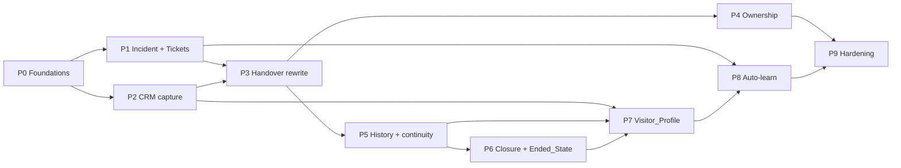

# Implementation Plan: CRM, Incident Handover and Visitor Profile

## Overview

This file is the single tracker for this feature. The architecture is in `design.md` and the rules are in `requirements.md`. Requirement refs use the form `R<n>.<criterion>`.

**How to use across sessions**
1. Read "Session log" (bottom) and "Current position" first.
2. Work one phase at a time, in order. Each phase is shippable behind its feature flag.
3. Tick `[x]` as tasks finish, then add a dated line to the Session log saying what was done, what is next, and any blockers.
4. Every phase ends with a checkpoint: backend `npx tsc --noEmit` passes, the relevant Jest/pytest/vitest suites pass, and the UI and widget build.

**Current position:** All code tasks done (Phases 0–9.3), reviewed and tested; 0.9 closed locally. Left: the staging checkpoints 1.10, 2.12, 3.8, 4.8, 5.8, 6.9, 7.10, 8.6 (a staging bot with the flags on) and 9.4, the production rollout, which is an ops step to run by hand following `docs/CRM-INCIDENT-HANDOVER.md` → "Rollout".

**Review rule (user, 2026-10-08):** after every task, review the code as a senior engineer: walk every scenario and edge case (concurrency, retries, tenancy, null/invalid input, preview mode, feature flag off), fix what is found, and add tests for it before ticking.

**Test runner note:** run Jest with Node 18 or 20 (`npx jest` on the current machine's Node 20; earlier sessions used `~/.nvm/versions/node/v18.20.8/bin/node node_modules/.bin/jest`). On Node 24, `@nestjs/schedule@2` crashes on the removed `util.isString`. New specs stub `@nestjs/schedule` so they also run on 24. The 43 scaffold "should be defined" suites fail on any Node and predate this work.

**Conventions**
- Backend repo `QuantumMind-backend`, AI repo `QuantumMind-ai`, Dashboard repo `QuantumMind-ui`, Widget repo `QuantumMind-widget`.
- New code never references KONE or myKONE (D10). Only the flow JSON data under `docs/koneTrainingData` may be KONE-specific.
- Visitor-facing paths never `await` the CRM or the AI for success. Use the outbox or retry crons instead.
- AI tests run in Docker, e.g. `docker run --rm -v "$PWD":/app -w /app quantummind-ai-ai-service:latest python -m pytest -q tests/...`.

---

## Tasks

## Phase 0 — Foundations

- [x] 0.1 Feature flags: add `BotSetting.features { crmCapture, incidentHandover, profileSummaries, closurePrompt, autoLearn }` (all default false), plus a `isFeatureOn(botSettings, key)` helper in `src/common/features.ts`.
  - _Design: Rollout §1_
- [x] 0.2 Org time zone: add `Organization.country` and `Organization.timeZone`. Add `src/common/time/country-zones.ts` (ISO-2 to primary IANA zone) and `formatInOrgTz(date, org)`, defaulting to UTC. Add a unit test.
  - _R22.1, R22.2_
- [x] 0.3 Org settings UI (QuantumMind-ui): a country select and a time-zone select, with the zone pre-filled from the country. Save through the existing org update endpoint, extending its DTO.
  - _R22.1_
- [x] 0.4 PII masker `src/common/pii/mask.ts`. It masks emails, phones (7 to 15 digits) and the values of secure QUESTIONS elements with `[email]`, `[phone]` and `[secure]`. Include fast-check tests showing no original value survives.
  - _R11.5, Property 9_
- [x] 0.5 CRM Prisma migration `crm_incident_profile`:
  - Add `RecordSource.CHAT`.
  - Add Contact columns `isAnonymous`, `phoneNormalized` (indexed), `visitorIds`, `altIdentifiers`, `fieldSources`, `profile`, `profileVersion`.
  - Add a raw-SQL partial unique index on `(organizationId, lower(email))` for active rows.
  - Add a pre-check script `scripts/crm-dup-check.ts` that lists duplicate emails and aborts.
  - Run `prisma generate`.
  - _Design: Data model_
- [x] 0.6 Mongo additive fields:
  - Conversation: `crmContactId, flowPosition, pendingIdentity, awaitingClosure, incidentOpen, transcriptState, messageCount, endedAt, endCause`.
  - Visitor: `crmContactId`.
  - Ticket: `incident, crmContactId, source`.
  - Question: `source`.
  - BotSetting: `contactMapping, problemAlias, problemQuestion, handoverMessage, closurePromptText, closingMessage, closureIdleMinutes`.
  - Flow node payload: `terminal`.
  - _Design: Data model; R15.4_
- [x] 0.7 `crm_outbox` collection plus `CrmOutboxService.enqueue(op, payload)` and a 1-minute drain cron with backoff at 1, 3 and 10 minutes, after which the item is marked failed. Include a unit test.
  - _R2.8, R3.9, R10.5_
- [x] 0.8 AI client in the backend: add `aiService.profileMerge`, `knowledgeCandidate`, `knowledgeSimilar` and `extractContact`. Each has a 60 s timeout and typed results. Put stubs behind the endpoints until P7 and P8.
  - _Design: AI service table_
- [x] 0.9 Checkpoint P0: tsc passes, Jest for the new utils passes, the UI builds, and the migration has been applied locally.

## Phase 1 — Incident core and Tickets

- [x] 1.1 `src/incident/`:
  - Entity with a unique partial index on `conversationId` for open statuses.
  - `@Global` module and provider, following the `handover-alert` module pattern.
  - _Design §1_
- [x] 1.2 `IncidentService.openForHandover(conv, {problem, flags, reason})`:
  - Idempotent per open incident.
  - Creates the Ticket first (with description and incident link), then the Incident.
  - Calls `HandoverAlertService.raise` and emits `incident.opened`.
  - _R4.2, R4.8, R19.1, Property 3_
- [x] 1.3 `accept`, `resolve(note 10 to 2000)`, `closeOnConversationEnd(cause)`, using conditional updates for single closure. Emit `incident.updated` and `incident.closed`.
  - _R10.1 to R10.7, Property 4_
- [x] 1.4 Listen to `conversation.ended` and call `closeOnConversationEnd`. Use `abandoned` when there is no agent and `closed_unresolved` when there is one, and leave `follow_up` incidents unchanged.
  - _R10.4_
- [x] 1.5 Tickets:
  - Extend `CreateTicketDto` and the entity with `incident`, `crmContactId` and `source`.
  - Have `markAsResolved` emit `ticket.resolved`.
  - Have `IncidentService` resolve the linked incident on that event.
  - _R1.2, R1.7, R15.4_
- [x] 1.6 Update `handleCreateTicket` in MH:
  - Build the description from the problem plus the configured attributes.
  - Write "No problem description provided" when there is none.
  - Reuse an open incident's ticket.
  - Show `ticketId` in the confirmation, not `_id`.
  - On failure, send one message and take the failure path.
  - _R1.1, R1.3, R1.6, R1.8, R1.9_
- [x] 1.7 Problem gate `ensureProblemDescription(userId)`:
  - Use the problem alias if set, otherwise ask once.
  - Re-ask once on a short answer, accept the second answer and flag it short.
  - Truncate past 1000 characters.
  - Drop the request after 10 minutes with no answer (cron).
  - Persist `awaitingProblem` on the Conversation.
  - _R4.1 to R4.7_
- [x] 1.8 Incident REST endpoints:
  - `GET /incidents?status&bot`, `GET /incidents/:id`, `POST /incidents/:id/resolve`.
  - Org-scoped, with roles ORG_ROLES.
  - _R10.1, R10.6_
- [x] 1.9 Tests:
  - IncidentService properties 3 and 4 with fast-check and a fake model.
  - `handleCreateTicket` description and ref.
  - Problem gate state machine.
- [ ] 1.10 Checkpoint P1.

## Phase 2 — CRM capture and identity

- [x] 2.1 Emit `attribute.captured {userId, conversationId, botId, keys}` from all attribute write sites: `captureUserInput`, `handleQuestion`, SET_ATTRIBUTES and `routeTemplateResume`.
  - _R2.1_
- [x] 2.2 `ContactResolver.resolve(orgId, details)`:
  - Validate email (R2.1) and normalise phone.
  - Match by email, then phone, with earliest-created winning among duplicates.
  - Create the contact (name splitting, Anonymous fallback) or fill empty fields only, respecting `fieldSources`.
  - Take an advisory lock per identifier.
  - _R2.2 to R2.7, R2.10 to R2.12, R17.6_
- [x] 2.3 Linking:
  - Set `crmContactId` on the Visitor and the Conversation.
  - Add to `Contact.visitorIds`.
  - Write one `chat_linked` Activity per conversation.
  - Keep an existing different link unchanged.
  - Route every write through the outbox on failure.
  - _R3.1, R3.2, R3.5, R3.7, R3.9_
- [x] 2.4 Ask once:
  - Add `ContactResolver.known(conv)`.
  - Before a QUESTIONS, USER_INPUT or OPEN_TEMPLATE node asks for a contact alias, pre-fill or skip it.
  - Send the confirm message with "Yes" / "Update details", and ask only for the chosen fields.
  - _R16.1 to R16.3_
- [x] 2.5 Returning visitor: when the widget resumes with a stored visitorId, load the linked contact as known details. Never use a host-page identity.
  - _R16.4 (revised), D10_
- [x] 2.6 Free-text extraction: when a message contains "@" or 7 or more digits, run regexes, then AI `extract/contact` if the result is ambiguous, and feed the values to the resolver.
  - _R16.5_
- [x] 2.7 Identity conflict prompt:
  - Show "Keep existing / Use new / Keep both".
  - Store "Keep both" values in `altIdentifiers`.
  - After 2 unanswered turns, write a `ContactFact` PROPOSED.
  - When email and phone point to different contacts, record a merge-suggestion Activity on both.
  - _R17.1 to R17.5_
- [x] 2.8 Anonymous contacts:
  - `ensureContact(conv, {anonymousOk})` creates "Anonymous visitor <id>" with `isAnonymous`.
  - Upgrade it in place on new details.
  - Merge into an existing match by moving links and archiving the anonymous record.
  - _R20.1, R20.3, R20.4_
- [x] 2.9 AI endpoint `POST /extract/contact` (QuantumMind-ai) with a pydantic model and a pytest using a stub provider.
  - _R16.5_
- [x] 2.10 UI:
  - CRM contact page: lists of linked conversations, incidents and tickets (newest first, 50 per page, empty states).
  - Anonymous badge.
  - Agent View header contact link, or "CRM contact unavailable".
  - "Add details" form for anonymous contacts.
  - _R3.3, R3.4, R3.6, R3.8, R20.2_
- [x] 2.11 Tests:
  - Property 1 (dedupe under concurrency) and Property 2 (fill-empty-only).
  - Conflict-prompt state machine.
  - Anonymous merge moves every link.
- [ ] 2.12 Checkpoint P2. Enable `crmCapture` on a staging bot.

## Phase 3 — Handover rewrite

- [x] 3.1 Rewrite `TransferToAgent` in this order:
  1. Problem gate.
  2. `ensureContact` (anonymous allowed).
  3. `openForHandover`.
  4. Send `handoverMessage` with `{{ticketId}}`.
  5. Silent `assignAgent` and alert offer.
  6. Take the SUCCESS branch.

  The FAILURE branch is taken only when creation fails. Remove the "No agent is available…" text.
  - _R19.1, R19.2, R19.5, D1, D2_
- [x] 3.2 While an incident is open and not Agent_Owned, the flow and the AI keep answering. Once Agent_Owned, the existing suppression applies.
  - _R19.3_
- [x] 3.3 When an agent accepts while the visitor is connected, tell the visitor the agent's name, then set `agent_active`.
  - _R19.4_
- [x] 3.4 Mail:
  - Add `MailsService.sendTemplate` and a `ticket-ack.hbs` template with dates in the org time zone.
  - Send the acknowledgement when a valid email exists.
  - Add `POST /incidents/:id/email-reply` and record an Activity for it.
  - _R19.4, R6.5 carried_
- [x] 3.5 Bot settings UI: handoverMessage, problemQuestion, problemAlias and contactMapping fields.
- [x] 3.6 Update the KONE flow data: `kone_set_ticket`/`kone_ticket_contact` must not pre-create the ticket. The incident creates it. Write the problem into `contact_topic` on both contact paths.
  - _R4.9 (revised by R19.1)_
- [x] 3.7 Tests: replay the KONE flow from "talk to agent" with no agent online. Expect exactly one incident, one ticket, one handover message, no "no agent" text, and the flow continuing.
- [ ] 3.8 Checkpoint P3. Enable `incidentHandover` on staging.

## Phase 4 — Ownership

- [x] 4.1 `ChannelThreadService.claim(threadId, userId)` as a conditional `findOneAndUpdate`. Route takeover and incident accept through it, and return 409 with the owner's name on conflict.
  - _R7.1, Property 5_
- [x] 4.2 Make release owner-only. A plain takeover by an admin no longer bypasses the check. Add `POST /inbox/threads/:id/override {targetAgentId?}` (admin only, validates the target, writes to `ownershipLog`, notifies the previous owner over the socket).
  - _R7.3, R7.4, R7.6, R7.7, R7.8_
- [x] 4.3 Owner-only replies: add a `not_thread_owner` rejection in `InboxService.sendMessage` and in the gateway's `chat-message-from-agent`.
  - _R7.2_
- [x] 4.4 Emit exactly one `inbox:thread-updated` per owner change, and none for a no-op.
  - _R7.5_
- [x] 4.5 Typing:
  - Add a gateway `agent-typing` handler, throttled to once per 3 s.
  - Fan out `inbox:agent-typing` to recipients, and `typing` to the visitor when `typingIndicator` is on.
  - Add a dashboard indicator that clears after 5 s.
  - _R8.6 to R8.8_
- [x] 4.6 UI, for both the inbox and the legacy views:
  - Build the ownership matrix as a pure function with vitest coverage.
  - Header text, buttons, and the composer's `disabledReason`.
  - Override confirmation dialog for admins only.
  - On rejection, keep the unsent text.
  - _R8.1 to R8.5, R8.9_
- [x] 4.7 Tests: concurrent `claim` property test, and owner-only send.
- [ ] 4.8 Checkpoint P4.

## Phase 5 — History and continuity

- [x] 5.1 `GET /incidents/:id/context`. It returns the chats (ascending, with senderRole), the contact profile, and up to 20 earlier incidents (with a pager). It is org-scoped.
  - _R9.1, R9.4, R9.6, R9.7_
- [x] 5.2 Add `conversationId` and `threadId` to the `new-visitor` payload. Have the UI's `pushToActiveConversations` load the full history automatically.
  - _R9.2_
- [x] 5.3 Persist `Conversation.flowPosition` on node change (debounced).
  - _Design §7_
- [x] 5.4 Widget resume:
  - Store `localStorage['jarcube.session.<botId>'] = {visitorId, conversationId, ended}`.
  - Have `POST /widget/visitor` accept `resume` / `newConversation`.
  - `WidgetService` returns the same ids plus a fresh token when the conversation is still open, and rebuilds socket state from `flowPosition`.
  - _R9.3, R9.11_
- [x] 5.5 Gateway `handleConnection`: skip `"start"` when resumed or when chats exist.
  - _R9.3, R14.7_
- [x] 5.6 UI:
  - Agent views load history from `/context`.
  - Earlier-incidents list, where each item shows the profile entry rather than the transcript.
  - Error and Retry handling that keeps the composer text.
  - Live append without duplicates.
  - _R9.1, R9.5 (revised), R9.8 to R9.10_
- [x] 5.7 Tests: resume logic as a pure function (widget), the `/context` org scope, and a history-completeness test.
  - _Property: R9.8_
- [ ] 5.8 Checkpoint P5.

## Phase 6 — Closure prompt and Ended_State

- [x] 6.1 Terminal detection: a SUCCESS, FAILURE or TIMEOUT node with no `next`, a node with `payload.terminal`, CLOSE_CHAT, or post-handover. Send the Closure_Prompt buttons and persist `awaitingClosure`. Skip all of this while Agent_Owned.
  - _R14.1, R14.11_
- [x] 6.2 Handle the visitor's response to the Closure_Prompt:
  - "Yes, resolved": closing message, end the conversation, emit `conversation-ended`, resolve the incident by the bot if one is open.
  - "Something else" or free text: go to the start node and process the text.
  - "Start again" or a restart keyword: restart in the same conversation.
  - Act only on the first response.
  - _R14.2 to R14.4, R14.10, R10.3_
- [x] 6.3 Idle-close cron, with `closureIdleMinutes` defaulting to 10 (range 1 to 60).
  - _R14.5_
- [x] 6.4 `handleCloseChat`: remove the "To start again type start" line and emit the Ended_State.
  - _R14.2_
- [x] 6.5 Widget Ended_State:
  - Disable input and buttons, show the notice and a "Start new chat" button.
  - Persist `ended`, and on reload show the state without connecting.
  - "Start new chat" calls `newConversation`.
  - _R14.6, R14.7, R14.9_
- [x] 6.6 Flow builder: add a "Terminal" toggle on SUCCESS, FAILURE, TIMEOUT and BOT_RESPONSE nodes. Bot settings: closure texts and idle minutes.
- [x] 6.7 KONE flow data: replace `kone_r_agent_busy → kone_goto_menu` with a terminal node.
  - _R14.8_
- [x] 6.8 Tests:
  - Closure state machine (Property 8).
  - KONE replay with no menu restart after the busy or handover message.
  - Reconnect in Ended_State sends no "start".
- [ ] 6.9 Checkpoint P6. Enable `closurePrompt` on staging.

## Phase 7 — Visitor_Profile (summaries replace transcripts)

- [x] 7.1 AI `POST /profile/merge`:
  - pydantic `VisitorProfile` v1 schema.
  - JSON-only prompt: append exactly 1 entry, keep every incident ref, keep adminOverrides, 8000-character cap, compression when asked.
  - pytest coverage with a stub provider plus contract tests.
  - _R18.2, R18.3, R18.9_
- [x] 7.2 Backend `ProfileService.merge(contactId, conversationId)`:
  - Prisma transaction with `SELECT … FOR UPDATE`.
  - Mask the chats before sending them.
  - Validate the result with zod: exactly one more entry, refs preserved, overrides kept, size limit.
  - Retry on compression failure.
  - Write `profileVersion+1`, plus a `session_summary` Activity.
  - _R18.1 to R18.4, R18.9, R18.11, Property 6_
- [x] 7.3 Retries at 30, 60 and 120 s with a 60 s timeout, then a deterministic fallback entry marked `ai:false`.
  - _R11.6, R11.7_
- [x] 7.4 `SessionLifecycle` listener on `conversation.ended` and the idle close:
  - Open incident: keep the chats.
  - No contact and no incident: purge.
  - Otherwise: merge, then purge.
  - Failure: set `pending_merge` and retry daily.
  - Write the counters before deleting.
  - _R18.5 to R18.7, R18.10, Property 7_
- [x] 7.5 Dry-run mode: in the first rollout, mark the conversation `would_purge` without deleting anything. Add a log report, then a flag switch to live deletion.
  - _Rollout §2_
- [x] 7.6 Use the profile:
  - Pass the facts and the 5 newest entries as `visitor_profile` to `/query/ask` and the AI node. The AI side adds them to the system prompt.
  - Show the profile panel in both agent views.
  - _R18.8_
- [x] 7.7 CRM contact page profile card:
  - Show the facts and the dated entries.
  - Admins can edit facts (stored in `adminOverrides`) and delete entries. The next merge respects both.
  - _R18.12_
- [x] 7.8 Anonymous merge also merges the profile entries in date order.
  - _R20.3_
- [x] 7.9 Tests:
  - Property 6 (monotonic refs and size under concurrent merges).
  - Property 7 (no deletion without a merge).
  - The masker applied to the merge input.
- [ ] 7.10 Checkpoint P7. Run the dry-run for one week on staging, review the profiles, then enable `profileSummaries` live.

## Phase 8 — Auto-learn from agent resolutions

- [x] 8.1 AI `POST /knowledge/candidate` (generalised Q&A with no PII, lengths validated) and `POST /knowledge/similar` (search restricted to the `incident:` prefix). Include pytest coverage.
  - _R21.1, R21.3_
- [x] 8.2 `KnowledgeService`, triggered on `incident.closed` with `resolved_by_agent`:
  - Generate the candidate and run the PII regex guard.
  - Dedupe at similarity ≥ 0.9.
  - Create or update an approved Question Bank entry with `approvedBy=SYSTEM` and `source.incidentIds`.
  - Call `addKnowledge` with source `incident:<id>`.
  - On failure, record `incident.knowledge.failed`.
  - _R21.1 to R21.3, R12.2, R12.9_
- [x] 8.3 Question Bank:
  - Allow the system-approval path only. The self-approval check stays for humans.
  - Edit and delete hooks call `removeKnowledge` / `addKnowledge` within 5 minutes.
  - _R21.1, R21.4_
- [x] 8.4 UI:
  - Question Bank: a "Learned from incident" label, a link to the incident, and edit and delete actions.
  - Bot dashboard: an agent-share card from `GET /reports/agent-share` with a 1% target line.
  - _R21.4, R21.5_
- [x] 8.5 Tests: PII guard, dedupe update path, and ingest/remove on edit and delete.
- [ ] 8.6 Checkpoint P8. Enable `autoLearn` on staging.

## Phase 9 — Hardening and release

- [x] 9.1 Full KONE replay suite covering:
  - anonymous handover, then adding details, then a merge
  - a returning visitor whose profile reaches the AI context
  - a two-agent race
  - closure, then a reload into the Ended_State
- [x] 9.2 Non-regression:
  - Flows with no handover behave identically, as checked by golden transcripts.
  - Preview mode creates nothing.
  - Existing CRM, Ticket and Question Bank endpoints are unchanged.
  - _R15.1, R15.2, R15.4_
- [x] 9.3 Docs: update `docs/OMNICHANNEL-INBOX.md` and add `docs/CRM-INCIDENT-HANDOVER.md` (operations, flags, migration, dry-run).
- [ ] 9.4 Production rollout:
  1. Run the duplicate check.
  2. Run `prisma migrate deploy`.
  3. Enable the flags in phase order for the KONE org.
  4. Monitor the agent-share metric.

---

## Task Dependency Graph



```json
{
  "waves": [
    { "wave": 1, "phases": ["P0"] },
    { "wave": 2, "phases": ["P1", "P2"] },
    { "wave": 3, "phases": ["P3"] },
    { "wave": 4, "phases": ["P4", "P5"] },
    { "wave": 5, "phases": ["P6"] },
    { "wave": 6, "phases": ["P7"] },
    { "wave": 7, "phases": ["P8"] },
    { "wave": 8, "phases": ["P9"] }
  ]
}
```

P1 and P2 can run in parallel after P0. P4 and P5 can run in parallel after P3. P7 deletes chats, so it must come after P5, because agents need history before transcripts can be dropped.

## Notes

## Deferred (not in this spec)

- Separate per-organization databases: dropped, not deferred (D11).

- Host-website identity (passing a logged-in user to the widget). This needs its own plan: a signed identity token (HMAC/JWT signed with a per-bot secret) with a verification endpoint, so a host page can never impersonate another user.
- WhatsApp and other channels (D7).

## Session log

- 2026-10-07: Requirements finalised (R1–R22, D1–D10). R&D completed against the code. `design.md` and this `tasks.md` were written. No implementation yet. **Next session: start Phase 0, task 0.1.**
- 2026-10-07: Per-org databases were considered and dropped (D11): all orgs share one CRM Postgres, isolated by `organizationId`. Phase 0A removed. **Next: 0.1.**
- 2026-10-08: Phase 0 implemented (0.1–0.8). Backend tsc clean; Jest `src/common src/crm-outbox src/ai` 96/96; UI tsc clean, vitest 26/26. Outbox spec mocks `@nestjs/schedule` because `@nestjs/schedule@2` calls `util.isString`, which local Node 24 removed (Docker uses node:16, so runtime is fine). AI CRM client methods are typed in `src/ai/ai-crm.types.ts`; the AI endpoints do not exist yet (P2/P7/P8), so calls throw and callers must fall back. **Blocker:** migration `20261008120000_crm_incident_profile` NOT applied, Docker daemon down. To close 0.9: start Docker, `npm run crm:dup-check`, `npx prisma migrate deploy`. **Next:** Phase 1, task 1.1.
- 2026-10-08 (review + P1): Senior review of Phase 0 found and fixed: (a) the new unique email index turned CRM contact create/update races, restore, bulk restore into 500s; now 409s, bulk restore fails per row (`src/crm/common/prisma-errors.ts`); (b) masker glued a date to adjacent numbers ("2026-10-07 12 people" was masked) and let date-shaped phones through; now dates are shielded only when plausible (19xx/20xx, valid month/day); (c) outbox: hung handler wedged the drain (30 s timeout added), a crash-looping item re-leased forever (counts as an attempt, ends FAILED), a slow worker could overwrite a re-leased item (lease guard on every write), FAILED items kept PII forever (TTL 30 d, DONE 7 d via `expireAt`), dedupe index used `$in` in a partial filter (Mongo 6+ only), oversized payloads now refused; (d) org settings Save disabled when a custom zone is empty. Phase 1 done: `src/incident/` (entity with unique open-per-conversation index, service, listener, controller `GET /incidents`, `GET /incidents/:id`, `POST /incidents/:id/resolve`, problem-gate rules, ticket description builder), tickets emit `ticket.resolved` (idempotent), HTTP callers cannot set `incident`/`crmContactId`/`bot` on tickets, `conversation.ended` now carries `cause` (close_chat/expired/disconnect/agent_release), TICKET node rewritten (R1), problem gate wired into `handleMessage` behind `incidentHandover`. `ensureProblemDescription` is ready but NOT yet called from TransferToAgent; that is task 3.1. Tests: incident 26, MH incident-ticket 10, outbox 12, mask 9; backend tsc clean. **Blocker unchanged:** apply migration. **Next:** Phase 2, task 2.1.
- 2026-10-09 (P2): Phase 2 done (2.1–2.11), reviewed per the review rule.
  - Backend `src/crm-bridge/`:
    - `identity.ts`: pure rules for email (R2.1), phone, name split, fill-empty-only plan, conflict detection, free-text regex, lock keys. Platform placeholder visitor values (`<id>@nomemail.com`, `0000000000`) are never treated as real.
    - `identity-prompt.ts`: choices, confirm text, alias mapping.
    - `contact-resolver.service.ts`:
      - matches by email then phone (digits compare, legacy `phone` column too), earliest wins, ignores archived and other-org rows;
      - takes a per-(org, identifier) `pg_advisory_xact_lock` in sorted order; a P2002 retries once;
      - conflict, Keep both / Use new / Keep existing; a person-owned field only ever gets a PROPOSED fact;
      - merge suggestion on both contacts, without copying the phone onto the email match;
      - anonymous contact keyed by full seed (`altIdentifiers.anonSeed`), upgraded in place or merged into the match (activities, visitorIds, profile entries moved, anonymous row archived);
      - idempotent `recordLink` (one `chat_linked` per conversation).
    - `crm-bridge.service.ts`: Mongo links on Conversation/Visitor/Incident/Ticket, keeps a different existing link (R3.7) and only replaces a merged anonymous one; repoints all Mongo rows after a merge; every CRM failure goes to the outbox with a dedupe key; outbox handlers registered.
    - `crm-bridge.listener.ts`: `attribute.captured` (contact aliases only) and `visitor.text` (regex, then AI `/extract/contact` only when ambiguous).
    - `crm-links.service.ts` + controller: `GET /crm/contacts/:id/links`, `GET /crm/conversations/:id/contact`, `POST /crm/conversations/:id/contact/details`, all pinned to the org's bots.
  - MessageHandler:
    - `attribute.captured` from every attribute write site (secure answers excluded);
    - free text not read while a QUESTIONS/USER_INPUT node is collecting;
    - identity conflict prompt (3 buttons, lapses after 2 turns into a proposal);
    - "ask once" pre-fill/skip with Yes / Update details, a 1.5 s cap on the CRM lookup, any other reply taken as an implicit yes.
  - IncidentService links or creates the anonymous contact (3 s cap, flag-gated).
  - AI: `POST /extract/contact` with verbatim-in-text checks and a regex fallback, 20 pytest (run in a temp venv, Docker down).
  - UI: contact page links tab (50/page, load more, empty/error states), Anonymous chips, agent-view header badge plus Add details dialog, `?conversation=` deep link in `/apps/chat/active`. `isAnonymous` added to the contact list/detail selects.
  - Tests:
    - backend crm-bridge 66, MH identity-flow 10; full Node 18 suite 277 pass, only the 43 old scaffolds fail;
    - UI vitest 41;
    - backend and UI tsc clean.
  - **Open:** 2.12 (enable `crmCapture` on a staging bot) and the migration (Docker down). Raw SQL in `findByPhone` and the advisory locks are only exercised against a fake; verify on real Postgres once the migration is applied. **Next:** Phase 3, task 3.1 (wire `ensureProblemDescription` + `openForHandover` into TransferToAgent).
- 2026-10-09 (P2): Phase 2 done (2.1–2.11). Backend `src/crm-bridge/`: `identity.ts` (pure rules: email R2.1, phone normalise, placeholder `@nomemail.com`/`0000000000` rejected, name split, fill-empty plan, conflict detect, free-text regex, advisory lock key), `contact-resolver.service.ts` (advisory-locked match-or-create, earliest wins, fill-empty-only with `fieldSources`, conflict outcome, Keep both -> `altIdentifiers`, PROPOSED facts for person-owned fields, merge suggestion on both when email/phone hit two people and the phone is NOT copied, anonymous contact keyed by full conversation seed, anonymous upgrade in place or merge-and-archive, idempotent `recordLink`), `crm-bridge.service.ts` (Mongo links on Conversation/Visitor/Incident/Ticket, existing different link kept R3.7, outbox ops `contact.resolve`/`contact.link`/`contact.anonymous`), listener (`attribute.captured`, `visitor.text` with AI extract only when ambiguous), `identity-prompt(.service).ts`, controller `GET /crm/contacts/:id/links`, `GET /crm/conversations/:id/contact`, `POST /crm/conversations/:id/contact/details`. MH: capture events at all write sites (never for secure answers), ask-once pre-fill/skip with confirm buttons (1.5 s CRM cap), conflict prompt with 2-turn lapse to PROPOSED, free text skipped while a QUESTIONS/USER_INPUT node is collecting. Incident open links an anonymous contact (3 s cap, flag-gated). AI `POST /extract/contact` (pytest 62 pass in a temp venv; re-run in Docker). UI: contact links lists, Anonymous chip, agent header badge + Add details dialog, `?conversation=` deep link. Tests: backend 277 pass (Node 18), UI vitest 41, tsc clean both. **Blockers:** migration not applied; Docker down. **Next:** Phase 3, task 3.1.
- 2026-10-09 (P3): Phase 3 done (3.1–3.7). `TransferToAgent` dispatches on `incidentHandover`: off = legacy path untouched; on = problem gate -> `openForHandover` (anonymous contact inside) -> one handover message (`handoverMessage` with `{{ticketId}}`, appended if missing; repeat request quotes the same ref) -> silent `assignAgent` that only points the alert at an online agent -> SUCCESS (or rest). FAILURE only when creation fails; "No agent is available…" never sent. AI `handover:true` with an open incident just answers. Inbox takeover on widget threads emits `agent.took.over` -> visitor told the agent's name once, incident `agent_active`; release emits `agent.released` -> `recordRelease`, re-announce on next takeover. Review fixes: no "specialist will connect" after an agent already joined mid-record; emergency on an open normal incident escalates once (flag, CRITICAL ticket, high alert) instead of being swallowed. Mail: `MailsService.sendTemplate` (recipient check, subject CRLF strip, 3 retries, `ORG_MAIL_FROM`), `ticket-ack.hbs` / `incident-reply.hbs`, `IncidentMailService` (ack once per incident claimed atomically, org-zone date, never to `@nomemail.com`, `no_email` retried on `crm.contact.linked`, status on `incident.mail.ack`), `POST /incidents/:id/email-reply` (owner or org admin, EMAIL Activity). Bot settings: `sanitizeIncidentSettings` on every BotSetting update (flags boolean-only, texts ≤500, alias regex, idle 1–60); UI `IncidentSettings` section with preview and alias validation blocking Save. KONE flow (generator `build_kone_flow.py` + regenerated JSON): `kone_ticket_contact` and `kone_ticket_emergency` removed (incident creates the ticket), busy texts removed, after "recorded" the bot rests on `kone_ai_rest` (AI keeps answering, no menu restart). Tests: backend 244 in touched suites (Node 18) incl. KONE replay (one incident, one ticket, one message, no availability text, AI continues), UI vitest 44, tsc clean both. **Blockers unchanged:** migration + Docker; re-import the KONE flow into the bot. **Next:** Phase 4, task 4.1.
- 2026-10-09 (P4): Phase 4 done (4.1–4.7). Backend: `ChannelThreadService.claim` / `releaseIfOwner` / `overrideOwner` / `ownerOf` (single conditional writes; owner name falls back to email); `setBotControl` routes takeover/release through them, admins get no bypass (409 `thread_owned_by_other_agent` + `ownerName`); `POST /inbox/threads/:id/override` (org admin only, target must be active + assigned to the bot + same org, conditional on the owner the admin saw -> 409 `ownership_changed`; logs `kind: override` on the open incident; notifies the previous owner via `inbox:ownership-overridden`; announces the new agent to the visitor); exactly one `inbox:thread-updated` per real change, none for a no-op; `sendMessage` rejects non-owners with `not_thread_owner` before persisting anything; legacy gateway `chat-message-from-agent` rejects non-owners with `chat-message-rejected {ownerName, text}`; gateway `agent-typing` (owner only, 3 s throttle) -> `inbox:agent-typing` to other recipients and `typing` to the widget when `typingIndicator` is on. UI: pure `ownership.ts` matrix (vitest + fast-check), `OwnershipControls` (header text, Take over disabled for others, Release owner-only, admin Override with confirm dialog that keeps state on cancel/failure), composer `disabledReason`, draft kept on ownership loss and restored after a `not_thread_owner` rejection (never-sent bubble removed), "<name> is replying…" clears after 5 s or on the owner's message; legacy `SendMsgForm` disables + restores text on `chat-message-rejected`. Widget: shows the typing dots on `typing`, clears after 5 s or on the next message. Review fixes: a duplicate handover trigger whose winner's ref is still being written is no longer treated as a failure (says "already recorded" without a ref); `winnerTicketWaitMs` overridable so property tests are not timing-bound (the full suite was flaky under load). Tests: backend 307 pass (3 consecutive full runs on Node 18; only the 43 old scaffold suites fail), incl. ownership 11 + gateway ownership/typing 6; UI vitest 53; tsc clean backend, UI and widget. **Blockers unchanged:** migration + Docker. **Next:** Phase 5, task 5.1.- 2026-10-09 (P5 wip): 5.1 done: `GET /incidents/:id/context` and `GET /incidents/by-conversation/:conversationId/context` (history-only when no incident). Chats read from the Chat collection by conversationId (time asc), sender roles via deriveSenderRole, secured rows masked, cap 2000; contact profile; earlier incidents 20/page with cursor (summary/outcome only, no transcript); org scoped (404). Tests: incident-context 6 incl. completeness property. Next: 5.2.
- 2026-10-09 (P5 wip): 5.2 done: `new-visitor` carries conversationId + threadId; dashboard dispatches loadOldChats on new-visitor; loadOldChats reads /incidents/by-conversation/:id/context (10 s timeout, 404 -> old /conversation/:id), merges with live rows via pure mergeHistory (dedupe by _id/id/chatId, time order; vitest 4 incl. property), records historyErrorById on failure, stores earlier/profile/incident on the conversation, only replaces the open chat. Next: 5.3.
- 2026-10-09 (P5 wip): 5.3 done (MH persistFlowPosition: 2 s debounce per visitor, skip unchanged node / preview / non-widget, conditional on IN_PROGRESS). 5.4 BACKEND done: pure `widget/resume.ts` (decideResume/parseResumeRequest, 10 tests), CreateVisitor DTO `resume`/`newConversation`, WidgetService resumes (fresh token, state rebuilt from flowPosition, start node fallback, keeps live state) or reuses the visitor with forceNew conversation; response now includes conversationId + resumed; createConversation only reuses open, non-ended conversations. 5.5 done (handleConnection skips start when resumed / hasHistory / mid-flow / agent-handled; 6 tests). Next: 5.4 widget side (localStorage per bot), then 5.6 UI.
- 2026-10-09 (P5 wip): 5.4 widget side done: `store/bot/session.ts` (localStorage `jarcube.session.<botId>` = {visitorId, conversationId, ended, savedAt}; 24 h max age; malformed/disabled storage ignored; resumeRequest: resume both, or same visitor + newConversation when ended / Start new chat), fetchVisitor attaches it and saves the server's ids, ChatContent treats a stored session as a known visitor (no start form on reload). `session.check.ts` assertions pass (widget has no test runner). `markSessionEnded` ready for Phase 6 Ended_State. Next: 5.6 UI.
- 2026-10-09 (P5): Phase 5 done (5.1–5.7). 5.6 UI: legacy ChatLog shows error + Retry on a failed history load (historyErrorById) and an Earlier incidents panel (pure earlierIncidents.ts: Not available for missing fields, newest first, dedupe; vitest 3); server rows get sender = visitor._id / agent / bot so they land on the right side; inbox view shows error + Retry (messagesErrorByThread, 10 s timeout, no auto-refetch loop after a failure) with the composer kept mounted. Backend: widget inbox threads read history by conversationId OR channelThread so pre-handover rows are never missing (R9.1). Review fix: resume re-checks the conversation is still IN_PROGRESS right before issuing a token; if the expiry cron closed it meanwhile, the same visitor gets a new conversation. Tests: backend 330 pass (2 full runs, only the 43 scaffold suites fail), incl. incident-context 6, resume 10, gateway connection 6; UI vitest 60; widget session.check passes; tsc clean backend, UI, widget. Not done (needs a running stack): the 'open earlier incident read-only' transcript view (R9.5) is moot under D9 since raw chats are deleted after merge, so the panel shows the stored summary; revisit if D9 changes. **Next:** Phase 6, task 6.1.
- 2026-10-10 (P6): Phase 6 done (6.1–6.8), reviewed per the review rule. Machine now has Node 20 only (no nvm 18); `npx jest` works on 20.
  - Backend:
    - `message-handler/closure.ts`: pure rules (reply parsing with trim/case-fold, restart words whole-message only, idle minutes clamp 1–60 default 10, `closureApplies` = flag on + widget only + not Agent_Owned, Terminal toggle on SUCCESS/FAILURE/TIMEOUT/BOT_RESPONSE, prompt/closing texts).
    - MH: `restOnTerminalNode` sends the prompt when closure applies (covers SUCCESS/FAILURE/TIMEOUT with no next, ticket/handover with nothing after it); `payload.terminal` overrides `next` (BOT_RESPONSE only when not a menu, responses delivered once); CLOSE_CHAT is a Terminal_Outcome (prompt). One prompt per wait; `awaitingClosure {sentAt, idleMinutes, closingMessage}` persisted on the Conversation.
    - Replies: claimed synchronously (first reply only, late clicks on the old prompt ignored). "Yes, resolved" -> `IncidentService.resolveByVisitor` (resolved_by_agent if an agent handled it, else resolved_by_bot) -> closing message -> `conversation-ended` socket event after it -> `endConversation(cause closure_resolved)`. "Something else" -> one question, start node positioned with its menu marked shown so the next input is matched, attributes kept. Free text -> processed at that position. "Start again"/start/reset/restart -> normal restart. A goto button also settles the prompt.
    - Idle cron `closeIdleClosures` (1 min, re-entrancy guarded): conditional `claimClosure` on sentAt so one instance/path wins; local state -> full close; no local state -> end in DB and propagate the closing message + Ended_State. Agent takeover clears the prompt (no countdown, R14.11).
    - `endConversation` now ends once (conditional on `endedAt`), sets `endedAt`/`endCause`, clears the prompt; a later disconnect/expiry changes nothing. `resumeFacts.ended` only for closure_resolved/idle/close_chat; `decideResume` returns `ended` (no token, nothing created) so a reload shows the Ended_State (R14.7); expiry/disconnect still start fresh (R9.11).
    - Incidents: `closure_resolved` and `idle` causes never close an incident on `conversation.ended` (R10.4 lists only CLOSE_CHAT/expiry/grace). An idle close leaves a recorded request open for follow-up; the handover alert is still acknowledged as ENDED.
    - Widget CLOSE_CHAT (6.4): prompt off -> thank-you, no "type start", Ended_State; state kept and marked `conversationEnded` (the old `end.conversation` deleted it at once, so delayed messages and "start" were lost). Other channels keep the legacy path exactly (R15.7).
    - Gateway: refuses visitor input on an ended conversation and re-sends `conversation-ended`; reconnect to an ended one sends no "start".
    - "Start new chat": WidgetService resets every per-conversation key on a new conversation; `SocketStateService.remove` ignores the disconnect of a socket opened for an older conversation (tagged at connect), so it can no longer delete the new state or expire it.
    - Review fixes: `sanitizeIncidentSettings` turned a cleared idle field ("" / null) into 1 minute; now null (= default 10). Cron clears a stale persisted prompt when the visitor already answered locally. Resume keeps an in-memory ended flag for the same conversation.
  - KONE flow: `kone_r_agent_busy` no longer exists (removed in P3). `kone_r_q_fail` (questionnaire abandoned -> main menu) is marked terminal (menu edge kept for prompt-off bots); `kone_r_agent_fail` drops "Type start to try again" (its CLOSE_CHAT now prompts). JSON regenerated.
  - Widget: `ended`/`endedNotice` in Redux; `conversation-ended` -> `markSessionEnded` (ignored when it names another conversation); reload with stored `ended` shows the Ended_State without a request or socket; `EndedPanel` (role=status) with "Start new chat" -> `newConversation` for the same visitor, log cleared; input, send and all buttons disabled. `session.check.ts` extended.
  - UI: `TerminalOutcome` modal for SUCCESS/FAILURE/TIMEOUT and a Terminal switch in the BOT_RESPONSE editor (payload kept, only `terminal` changes); settings: "Ask if the query is resolved" flag, prompt text, closing message, idle minutes (1–60, blocks Save when invalid).
  - Tests: backend full suite 410 pass, only the 43 old scaffold suites fail; new: closure 31 (incl. fast-check), closure-flow 19 (KONE replay: one prompt + no menu after the failed handover, success path unchanged, each reply, race, idle, multi-instance idle, Agent_Owned, Terminal toggle, prompt off, other channel, preview), gateway Ended_State 2 (suite 9), conversation-ended 10, socket new-chat 3, incident-settings 14, resume 11 (+2); handover-replay 5 still green on the regenerated flow. UI vitest 65 and `next build` succeed. Widget tsc + build clean, session.check passes. Backend and UI tsc clean.
  - **Open:** 6.9 (staging with `closurePrompt` on; migration + Docker as before). Deploy widget and backend together: an old widget ignores `conversation-ended` and gets no token on an `ended` resume. Re-import the KONE flow. **Next:** Phase 7, task 7.1.
- 2026-10-10 (P7): Phase 7 done (7.1–7.9), reviewed per the review rule. Docker is up now (CRM Postgres, Milvus, AI image); the CRM migration is applied locally.
  - AI (`QuantumMind-ai`): `POST /profile/merge` (`routers/profile.py`, `services/profile_merge.py`, models in `schemas.py`). The model only writes the new entry's summary/tags/outcome and the updated facts; the profile is assembled in code: exactly one entry per conversation (idempotent on `conversation_id`), earlier entries copied as-is, incident fields copied from the request, `adminOverrides` re-applied, open issues tied to a ref only dropped when that incident resolves, entry time in the org zone (unknown zone -> UTC), oversize -> oldest entries folded into `earlier` (keeps every ticketRef/incidentId and a count; model summary with a deterministic fallback). Bad model output / provider error -> 502. `/query/ask` takes optional `visitor_profile`, rendered as a bounded "What we know about this visitor" block (`services/visitor_context.py`). pytest: 19 new + 2 query; full suite 256 pass (`docker run --network host ... pip install pytest`; the image has no pytest).
  - Backend `src/profile/`:
    - `profile-schema.ts` (pure): strict validation of the AI result (`checkMerged`: one entry for the conversation, total count +1 including `earlier.count`, every ref kept, overrides unchanged, ≤8000 chars or `tooBig` -> compress retry), lenient parse of stored data, `fallbackEntry` (`ai:false`), `fitProfile`/`foldInto`, `rebase`, admin `setFactOverride`/`clearFactOverride`/`deleteEntry`, `profileForAi` (facts + 5 newest).
    - `ProfileService.merge`: chats masked (`maskPii`, secure rows -> `[secure]`), incident problem/resolution masked, org tz, agent name; up to 4 attempts at 30/60/120 s (60 s client timeout); fallback only when the caller allows it. **Design deviation:** no row lock is held across the minutes-long AI call. The write is a compare-and-set under `SELECT … FOR UPDATE`; if `profileVersion` moved meanwhile (other conversation, admin edit, anonymous merge) the merge is rebased onto the latest profile. Same no-lost-update guarantee (R18.11), verified against the real local Postgres (temporary check, removed). One `session_summary` NOTE Activity per merge. Validation is hand-written, not zod (zod is not a dependency).
    - `lifecycle.ts` (pure) + `SessionLifecycleService`: on `conversation.ended` (not `agent_release`) and `incident.closed`; widget only, `profileSummaries` flag; open incident -> keep; no contact and no incident -> purge; else merge then delete; expired-but-recently-active left alone 30 min; per-conversation lease; counters written before delete; failure -> `pending_merge` + `mergeAttempts`. Daily cron 03:30 retries `pending_merge`, picks up missed end events, repairs a done-but-not-deleted conversation, logs a dry-run report. **Choice:** the `ai:false` fallback is used only on the 4th run (end + 3 daily retries), so R18.10 (keep chats, retry daily) wins over R11.7's 10-minute fallback; a conversation that never gets a contact stops at `kept` with its chats.
    - Dry run (7.5): global `PROFILE_PURGE_MODE` env, default `dry_run` (profiles merged, chats only marked `would_purge`); `live` deletes, and finishes earlier `would_purge` rows without re-merging. An env switch, not a per-bot flag, because deletion is irreversible and should be an ops decision.
    - `ProfileController`: `GET /crm/contacts/:id/profile` (org users), `PUT …/facts`, `DELETE …/facts/:key`, `DELETE …/entries/:key` (org admins), org-scoped (404), each edit bumps the version and writes a `profile_edit` Activity.
    - MH: `visitor_profile` on both `/query/ask` calls when `profileSummaries` is on, not in preview, capped at 500 ms (cached 5 min, 1 min when empty).
    - Anonymous merge (7.8): `mergeProfiles` rewritten on the schema: entries one per conversation in date order, both `earlier` buckets combined (refs, counts, range), facts of the real contact win, open issues de-duplicated, size capped; bumps `profileVersion` so an in-flight merge rebases.
    - Review fix: the PII email regex missed RFC 5322 local-part characters ("!x@a.io", "a/b@c.io"), found by the new property test; fixed in `common/pii/mask.ts` with a regression test.
  - UI: `views/crm/visitorProfile.ts` (pure, vitest 6), `VisitorProfileCard` (facts with "(edited)", open issues, dated entries newest first, earlier history; admin edit dialog keeps the text on failure, delete confirm), "Visitor profile" tab on the contact page (edit for `org_admin` only), `VisitorProfilePanel` in the legacy active chat (from `/context`) and inbox widget threads (looked up by conversation); `profileSummaries` switch in bot settings.
  - Tests: backend full suite 485 pass, only the 43 old scaffold suites fail; new: profile-schema 20 (incl. Property 6 fast-check over inserts/rebases/anonymous merges), profile.service 17 (masking property, retries, fallback, compress, idempotency, admin edit during merge, Property 6 under concurrency), session-lifecycle 26 (incl. Property 7), visitor-profile 4, mask +1. UI vitest 71, tsc clean. Backend tsc clean.
  - **Open:** 7.10 (one week of dry run on staging, review profiles, then `PROFILE_PURGE_MODE=live`). Rebuild/redeploy the AI image so `/profile/merge` exists; until then merges fail and chats are kept (safe). **Next:** Phase 8, task 8.1.
- 2026-10-10 (P8): Phase 8 done (8.1–8.5), reviewed per the review rule. R12's human-approval flow is superseded by R21/D6 (learned entries go straight to `approved`); R12.2/R12.8/R12.9 rules kept.
  - AI: `POST /knowledge/candidate` (`services/knowledge_candidate.py`: JSON-only prompt, lengths 10–500 / 10–2000, guard rejects email, phone, `SR_…` refs and placeholders -> 502). `POST /knowledge/similar` (`routers/knowledge.py`): best match among one tenant's `incident:*` chunks via new `VectorStoreService.search_source_prefix`; prefix restricted to `[A-Za-z0-9:-]` (it is a Milvus LIKE). pytest 23 incl. a real-Milvus prefix + tenant-isolation test; full suite 279 pass.
  - Backend `src/learn/`:
    - `learn-rules.ts` (pure): `maskForLearning` (maskPii + contact name parts + the incident's ref + any `SR_` ref), `checkCandidate` (lengths + the same guard again on the AI output), `shouldLearn` (resolved_by_agent and a 10+ character note).
    - `LearnService`: on `incident.closed`; flag `autoLearn` checked before anything is written; `IncidentService.claimKnowledge` is a conditional update so one incident yields at most one entry (stale 30-min claim re-taken); 3 attempts at 0/30/60 s, then `knowledge.status=failed` + `incident.knowledge.failed`. Dedupe: same question text in a learned entry, or `/knowledge/similar` ≥ 0.9 within `incident:*` -> `addIncidentToLearned` (incident ids + links kept, new answer added once, max 5). Human-written entries are never modified. New entry: `approved`, `addedBy` = agent, `source {kind, incidentIds, incidents[{id,ticketId,ticketRef}], clientId=botId, knowledgeSource=incident:<id>, systemApproved, ingest}`; ingested via `addKnowledge`. A crash after the claim records `failed` instead of leaving it `generating`.
    - Knowledge-base mirroring: approved -> ingest, otherwise -> `removeKnowledgeSource` (new, idempotent on 404). Failures go to the CRM outbox (`learn.sync`, `learn.remove`, retries 1/3/10 min); new `crm.outbox.failed` event -> entry shows `ingest.status=failed` (R12.8).
    - Question Bank: `QUESTION_CHANGED` / `QUESTION_DELETED` events from update, status change and delete of learned entries -> re-sync within the outbox budget (R21.4). **Bug fixed:** the self-approval check compared an ObjectId with a string (`===`), so it never matched and anyone could approve their own entry; now compared as strings. The system path never goes through it.
    - `GET /reports/agent-share?bot&months` (`learn.controller.ts`): per UTC calendar month, conversations vs distinct conversations with an incident, share (null with no chats), target 0.01; bot outside the org -> 404.
  - UI: `LearnedBadge` ("Learned from incident" chip, sync warning, source links to the service requests) in the Question Bank list (edit/delete already there); `AgentShareCard` on the bot settings page (text value per month, target line); `autoLearn` switch in bot settings. Pure helpers `learned.ts`, `agentShare.ts` with vitest.
  - Tests: backend full suite 538 pass, only the 43 old scaffold suites fail; new: learn-rules 26 (incl. masking property), learn.service 19, claim-knowledge 9, questions.learned 5, outbox +1. UI vitest 76, tsc clean. Backend tsc clean.
  - **Open:** 8.6 (enable `autoLearn` on a staging bot). Redeploy the AI image for `/knowledge/*`; until then generation fails and is recorded on the incident (nothing published). **Next:** Phase 9, task 9.1.
- 2026-10-11 (P9): 9.1–9.3 done; 0.9 closed (migration applied locally, `npm run crm:dup-check` OK). 9.4 not run: production rollout is a manual ops step (runbook in `docs/CRM-INCIDENT-HANDOVER.md`).
  - `src/e2e/` (real KONE flow, real MessageHandler + IncidentService, in-memory Mongo via the extended `profile/fakes.testspec.ts`):
    - `kone-journey.spec.ts`: two agents race (real `ChannelThreadService.claim`): one owner, one "joined" notice, loser cannot accept or resolve, single closure; closure -> "Yes, resolved" -> ended in a real `ConversationService` -> `decideResume` = ended -> gateway reconnect sends no "start" -> a later disconnect does not re-end; preview with every flag on writes nothing (no incident, ticket, CRM call, alert, profile read, chat rows, AI summary calls).
    - `kone-golden.spec.ts` (R15.2): five non-handover paths (menus, AI answers, reports/tenders, unreachable connector + CLOSE_CHAT, unconfigured segment) give identical transcripts, AI questions and node path with crmCapture/incidentHandover/profileSummaries/autoLearn on vs off, zero incidents; flags-off transcript stored as a Jest snapshot (golden). closurePrompt excluded (R14 differences are allowed). Not a comparison with pre-feature code: the last commit also predates unrelated uncommitted work, so flags-off is the baseline.
    - `api-compat.spec.ts` (R15.4): every CRM / tickets / questions route at HEAD still exists with the same method (read from Nest metadata), stored Ticket/Question fields from HEAD kept, old request bodies still validate. Review of the diffs: only additive DTO fields from this feature; the auth/`@Public` removals in those controllers come from the multi-tenant RBAC work, not this spec.
    - `kone-crm.int.spec.ts` (opt-in, `npm run test:crm-int`, real CRM Postgres, own org id, cleans up): anonymous handover -> agent "Add details" with the existing contact's email -> merge (anonymous archived, every Mongo row repointed, one chat_linked, profile entries combined newest first, one active contact); conversation end -> dry-run lifecycle -> profile entry with the ticket ref, masked input, one session_summary; returning visitor's next AI request carries the profile; two concurrent merges of one contact keep both entries; preview writes nothing. First run of the advisory locks, unique index and raw SQL against real Postgres: all pass.
  - **Bug found and fixed (R16.4, R18.8):** a returning visitor's new conversation was never linked to their contact, so the AI never got the profile and the lifecycle would purge that chat without summarising it. New `CrmBridgeService.linkReturning` (crmCapture on, not preview, contact not archived, never throws), called fire-and-forget by `WidgetService` for a known visitor's new conversation; `ProfileService.contextForConversation` also falls back to the visitor's contact for the first message. Unit tests `crm-bridge.returning.spec.ts` (8).
  - Docs: `docs/CRM-INCIDENT-HANDOVER.md` (flags, settings, migration, deploy-together, rollout order with checks, dry run and the live switch, jobs, endpoints, troubleshooting, tests). `docs/OMNICHANNEL-INBOX.md`: admin no longer bypasses ownership; new section on claim/override/owner-only replies/typing; typing gaps updated.
  - Tests: backend full suite 568 pass, 4 skipped (the opt-in Postgres suite, 4/4 pass with `CRM_IT=1`), only the 43 old scaffold suites fail. Backend tsc clean (also `tsconfig.build.json`). No UI, widget or AI changes in this phase.
