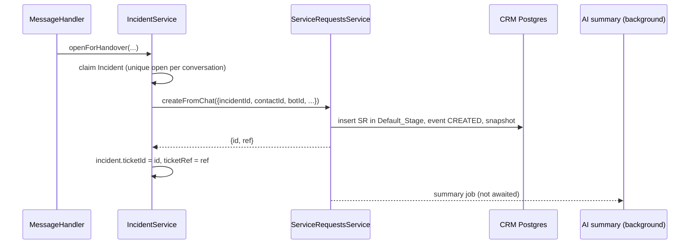

# Design Document: CRM Plugins, Service Desk and Contact Capture

## Overview

This design makes the CRM the single home of customer data and requests:

- one Contact_Capture path that saves every visitor's details to a CRM contact and renames the conversation
- a plugin registry with per-organization settings that drives the CRM menu, pages and APIs
- Service Requests in CRM Postgres, worked on a configurable kanban board with assignment, AI summary, transcript, history and comments

The authority is `requirements.md` in this folder (`R<n>.<criterion>`, decisions `D1`–`D7`). Terms from `.kiro/specs/crm-incident-handover` are reused as defined there.

**Out of scope**

- Migrating existing Mongo tickets (D1).
- SLA targets and due dates on Service Requests.
- Custom fields on Service Requests (the `FieldEntity` enum gains `SERVICE_REQUEST` only for saved views).
- Plan-based plugin limits (D2).

**Progress tracking.** `tasks.md` is the single tracker. Each phase ships on its own and leaves the system working.

---

## Current state (verified in code)

| Area | Fact | Location |
|---|---|---|
| Capture gate | `captureFromAttributes`, `onVisitorText` and `ensureAnonymous` return early unless `features.crmCapture` (default false). | `crm-bridge/crm-bridge.service.ts`, `crm-bridge.listener.ts`, `bots/entities/bot-setting.entity.ts` |
| Capture fields | `readDetails` reads only the mapped aliases. QUESTIONS validation types `jarcube.email` / `jarcube.phone_number` are not used. | `crm-bridge/identity.ts`, `message-handler/enums/user-input-validation.enums.ts` |
| Mongo write-back | `link()` writes only `crmContactId`. Nothing updates `Visitor.name/email/phone`. | `crm-bridge.service.ts` |
| Socket name | `handleMessage` sets `visitorName: user?.auth?.name` on every message. | `message-handler.service.ts` ~L484 |
| Inbox name | `toThreadName` = `thread.pushName` → `Visitor.name` → phone. `publishThreadUpdated` exists, nothing calls it for a name change. | `inbox/inbox.mapper.ts`, `inbox/inbox-events.service.ts` |
| Pre-chat form | `WidgetService.createVisitor` creates the Visitor, never calls the bridge; `anonymous: body.email ? true : false`. | `widget/widget.service.ts` |
| Social | `ChatInitializerService.initializeChat` creates visitor + conversation. WhatsApp passes `name, phone`; WhatsApp-web `pushName, phone` (absent for `@lid`); Telegram and Facebook a name only. | `chat-initializer/`, `whatsapp/`, `whatsapp-web/whatsapp-web-inbound.service.ts`, `telegram/`, `facebook/` |
| Tickets | Mongo `Ticket`, tenant only via `bot`. Writers: `TicketsService.create/assignTicketToMe/markAsResolved/update`, `IncidentService.openForHandover/escalate`, `MH.handleCreateTicket`, `CrmBridgeService.link/repointMongo`. Readers: `CrmLinksService`, `TagService`, `BotsService.getTotalCount`, `AgentService` (`Agent.serviceRequests[]`), `VisitorService` (`Visitor.serviceRequests[]`), stats/report routes. | `tickets/**` and the files named |
| Ticket routes | `POST /tickets`, `GET /tickets`, `assign-to-me`, `mark-as-resolved`, `stats`, `stats/home`, `stats/home/pending`, `report/total`, `report/day-wise-performance`, `report/date-wise-performance`, `GET/PATCH /tickets/:id`. No `mark-as-deferred`. | `tickets/tickets.controller.ts` |
| Incident link | `Incident.ticketId` is an ObjectId ref to `Ticket`; `ticketRef` the `SR_…` string. | `incident/entities/incident.entity.ts` |
| Chat deletion | `SessionLifecycleService` calls `deleteChats(conversationId)` after the profile merge in `live` mode. | `profile/session-lifecycle.service.ts` |
| CRM | Prisma/Postgres, `CrmPrismaService.forOrg`, `@OrgId()`; `CrmModule` aggregates feature modules; controllers have no `@Roles` (default `ORG_ROLES`). | `prisma/schema.prisma`, `src/crm/**` |
| Roles | `RolesGuard` global; `ORG_ROLES` = admin, manager, agent; `ORG_STAFF` = admin, manager. `ROLE_TABS` mirrored in UI. | `common/guards/roles.guard.ts`, `common/enums/role.enum.ts`, `common/constants/role-tabs.ts`, UI `utils/role-tabs.ts` |
| UI nav | CRM children hard-coded; `navigation(role, features)` filters by tab and plan features. | UI `navigation/vertical/index.ts`, `layouts/UserLayout.tsx` |
| UI DnD | No drag-and-drop library installed. | UI `package.json` |
| AI | `/generate/summary` summarises a template submission dict, not a transcript. | `QuantumMind-ai/app/routers/generate.py` |
| IDs | `generateId("SR", 6)` → `SR_` + nanoid(6). | `util/generate.id.ts` |

---

## Architecture

```mermaid
flowchart LR
  subgraph Sources
    F[Widget pre-chat form]
    Q[Flow questions / templates / free text]
    S[WhatsApp / WA-web / Telegram / Facebook]
    A[Agent "Add details"]
  end
  F & Q & S & A --> CC[ContactCaptureService]
  CC --> V[(Mongo Visitor + socket state)]
  CC --> EV[Inbox / visitor-updated events]
  CC --> CR[ContactResolver]
  CR --> PG[(CRM Postgres)]

  subgraph Requests
    TN[TICKET node] --> SRS
    HO[IncidentService.openForHandover] --> SRS
    UI[Dashboard create] --> SRS
  end
  SRS[ServiceRequestsService] --> PG
  SRS --> RT[SR realtime fan-out]
  SRS --> SUM[SR summary job] --> AI[QuantumMind-ai]
  SL[SessionLifecycle] -- snapshot before delete --> SRS

  PL[CrmPluginService] --> PG
  PG2[CrmPluginGuard] --> PL
```

### Key flows

**In-chat capture (R1, R3, R4)**

```mermaid
sequenceDiagram
  participant V as Visitor
  participant MH as MessageHandler
  participant L as CrmBridgeListener
  participant CC as ContactCapture
  participant M as Mongo Visitor
  participant CR as ContactResolver
  participant UI as Dashboard
  V->>MH: answers "What is your phone?" (jarcube.phone_number, alias "phone")
  MH->>MH: attributes.phone = value; typed answer also sets contact_phone if empty
  MH-->>L: attribute.captured
  L->>CC: capture(ctx, details, source=widget_chat)
  CC->>M: update name/email/phone, socket visitorName
  CC-->>UI: inbox:thread-updated / visitor-updated
  CC->>CR: resolve (email/phone) or fillName (name only, linked contact)
  CR-->>CC: contactId (link Visitor, Conversation, Incident, SRs)
```

**Service Request from handover (R9)**



---

## Components and Interfaces

### Backend (QuantumMind-backend)

#### 1. `ContactCaptureService` (new, `src/crm-bridge/contact-capture.service.ts`)

```ts
type CaptureSource = 'widget_form'|'widget_chat'|'template'|'whatsapp'|'whatsapp_web'|'telegram'|'facebook'|'agent';

capture(ctx: CaptureContext, raw: RawDetails, source: CaptureSource,
        opts?: { noConflictPrompt?: boolean }): Promise<CaptureResult | null>
```

Steps, never throwing to the caller:

1. Skip in preview (R1.10). `details = cleanDetails(raw)`.
2. **Mongo first (R1.9, R4.1).** `applyToVisitor(visitorId, details)`:
   - name replaces empty / "Anonymous" / any older value; email replaces empty / `@nomemail.com` / older; phone replaces empty / placeholder / older.
   - Writes only changed fields. Returns `nameChanged`.
3. **Live state (R4.2).** When the name changed and the socket entry is on this conversation: `socketState.updateUserData(visitorId, { visitorName, nameCaptured: true })`.
4. **Notify (R4.4)** when the display name changed: emit `visitor.details.updated {visitorId, conversationId, botId, name}`. `InboxEventsService` listens, finds the widget thread for the conversation (or the social thread), and calls `publishThreadUpdated`. `MessageHandler` listens and emits `visitor-updated {conversationId, visitorId, name}` to the assigned agent (`assignedAgentId`).
5. **CRM.**
   - `hasIdentifier(details)` → existing `bridge.capture(ctx, details, opts)`; on a created contact set `sourceChannel = source` (R5.1) via `resolver.resolve(..., { sourceChannel })` (written only in the create branch).
   - name only → when `linkedContactId(conversationId)` exists, `resolver.fillName(orgId, contactId, name)` (planFill + anonymous upgrade, inside the same advisory-lock transaction pattern). No create (R1.6, D7).

Callers:

| Source | Call site |
|---|---|
| `widget_form` | `WidgetService.createVisitor`, after `createConversation`, fire-and-forget with `{name, email, phone}` (not for `new_conversation` resumes without new details). |
| `widget_chat` / `template` / social channel | `CrmBridgeListener.onAttributeCaptured` and `onVisitorText` (source from `s.platform`; `template` when the event comes from `template.submitted`). |
| `whatsapp`, `whatsapp_web` | `ChatInitializerService.initializeChat`, after the conversation is created, when `visitorData.phone` is present. |
| `telegram`, `facebook`, `whatsapp_web` (`@lid`) | `ChatInitializerService.initializeChat` with the platform name and a Channel_Identity (Telegram `from.id`, Messenger PSID, WhatsApp `…@lid`) (R1.4, R1.5, R22). The Telegram visitor `username` becomes the user id (R22.5). |
| `agent` | `CrmLinksService.addDetails` (replaces its direct `bridge.capture`). |

#### 1a. Versioned identifiers and platform ids in `ContactResolverService` (R21, R22)

- `CleanDetails` gains `channel?: { kind: 'TELEGRAM'|'FACEBOOK'|'WHATSAPP_LID'; value }`; `hasIdentifier` counts it.
- Lookups: `findByEmail` / `findByPhone` check the contact columns (rows written by hand) **or** `ContactIdentifier`; `findByChannel` checks `ContactIdentifier`. Earliest-created active contact wins. Advisory locks per identifier as before (`e:`, `p:`, `c:kind:value`).
- On a match, `planFill` writes a different email/phone as the new Current value (no conflict outcome, no visitor question); the name keeps fill-empty-only. Every given value is claimed with `claimIdentifier` (upsert; bump `lastSeenAt`; take over a row whose contact is archived; never steal from another active contact). The previous Current value is claimed before it is replaced, so rows written before this feature keep their history.
- Placeholder contacts = anonymous **or** platform-only (no email, no phone, no company, name set by chat). Upgrade in place when nothing else matches; merged into the match otherwise (identifiers, activities, deal links, visitor ids, profile).
- `fillName(orgId, contactId, name)` for name-only captures on a linked contact.
- The identity-conflict prompt (`IDENTITY_CONFLICT`, `IdentityPromptService.settle`) is no longer triggered; it only finishes prompts already pending and is removed in Phase 5.

#### 2. Capture gate removal (R2)

- The `crmCapture` checks in `captureFromAttributes`, `ensureAnonymous`, `linkReturning` and the free-text listener are removed (preview is still skipped).
- `BotSetting.features.crmCapture` stays and now means only "ask once" (`isAskOnceOn(settings)` in `src/common/features.ts`, used by the prefill/confirm path and `IdentityPromptService.known`).

#### 3. Field recognition (R3)

- `identity.ts`: add `NAME_ALIASES` and `readDetails(attributes, mapping, typed?)`:
  - mapped alias first; when the mapped name alias is empty, first non-empty of `NAME_ALIASES`.
  - `typed` is `{ email?: string; phone?: string }` from the answer just accepted.
- `MessageHandlerService.handleQuestion` and `captureUserInput`: when the accepted element's `entity` is `jarcube.email` or `jarcube.phone_number` and it is not `secure`, also write the value to the mapped email/phone alias if that alias is empty, then `emitAttributeCaptured` with both keys. This keeps the existing "ask once" prefill (`aliasField`) working for later questions.
- The listener's alias pre-filter (`p.keys.some(k => aliases.has(k))`) adds `NAME_ALIASES`.

#### 4. Socket name fix (R4.3)

`handleMessage`: set `visitorName` from `user.auth.name` only when the state has no `nameCaptured` flag and the token name is not "Anonymous". `WidgetService.createVisitor` resets `nameCaptured` with the other per-conversation keys; `resumeSession` sets it when the stored Visitor name is real.

#### 5. Plugins (`src/crm/plugins/`, new)

```ts
// plugin-registry.ts
export interface CrmPluginDef {
  key: 'contacts'|'service-requests'|'companies'|'deals';
  label: string; description: string; icon: string;
  menuPath: string;            // '/crm/contacts'
  apiPrefixes: string[];       // ['crm/companies']
  core: boolean; defaultEnabled: boolean;
  dependsOn: CrmPluginKey[];
}
export const CRM_PLUGINS: CrmPluginDef[] = [/* contacts, service-requests, companies, deals(dependsOn companies) */];
```

- `CrmPluginService`
  - `list(orgId)` → registry merged with `CrmPluginSetting` rows: `{key, label, description, icon, menuPath, core, enabled, position, dependsOn}` sorted by position. Unknown stored keys ignored (R6.4).
  - `isEnabled(orgId, key)`; in-process cache per org, TTL 30 s (R8.5), invalidated locally on write.
  - `setEnabled(orgId, key, enabled, userId)`: core → 400. Enable → also every `dependsOn` (transitively). Disable → also every enabled plugin that depends on it; returns the list of plugins changed. One transaction. Writes `updatedById` (R7.7).
  - `reorder(orgId, keys[], userId)`.
- `CrmPluginController` (`crm/plugins`): `GET` (`ORG_ROLES`), `PATCH :key {enabled}` and `PUT order {keys}` (`@Roles(...ORG_STAFF)`). `PATCH ?dryRun=true` returns the plugins that would change, for the confirm dialog (R7.4).
- `@RequiresCrmPlugin(key)` decorator + `CrmPluginGuard`, applied at class level on `CompaniesController`, `DealsController` and their sub-routes (company/deal activities, fields with `entity=COMPANY|DEAL`, saved views of those entities). 403 `"The Deals module is turned off for your organization"` (R8.3). Core plugins never block.
- `StatsService` (`crm/stats`): companies / open deals / pipeline value are returned only for enabled plugins; adds `openServiceRequests`.

#### 6. Service Requests (`src/crm/service-requests/`, new; part of `CrmModule`)

**`ServiceRequestsService`**

```ts
createFromChat(input: {
  orgId?: string; botId: string; botName?: string; channel?: string;
  conversationId?: string; visitorId?: string; incidentId?: string; contactId?: string;
  subject: string; description?: string; emergency?: boolean;
}): Promise<{ id: string; ref: string }>
create(orgId, user, dto)                       // dashboard; source 'dashboard'
list(orgId, user, filters): { data, count } | { columns: [{stage, count, data, hasMore}] }
byId(orgId, id)
update(orgId, user, id, patch)                 // subject, description, priority, tags, contactId, emergency
move(orgId, user, id, { stageId, beforeId?, afterId? })
assign(orgId, user, id, assigneeId | null)     // validates same-org active user
comments: add / edit (author) / remove (author or staff)
events(orgId, id, page)
linkContactForConversation(orgId, conversationId, contactId, replaceableId?)
setStageCategory(orgId, id, category, actor)   // used by /tickets compat + incident accept
snapshotTranscript(orgId, id) / snapshotForConversation(conversationId)
```

Rules:

- **Org.** `createFromChat` resolves `orgId` with `TenantScopeService.orgIdForBot` when not given. No org → throws (caller takes its failure path, R9.8).
- **Reference.** `generateId('SR', 6)`; insert; on unique violation of `(organizationId, ref)` retry up to 5 times (R9.4).
- **One per incident.** Unique `incidentId`; a violation returns the existing row (R9.5). This replaces `IncidentService.linkTicketIfMissing`'s Mongo logic.
- **Placement.** Default_Stage, `boardPosition` = min position in that stage − 1 (new on top). Priority MEDIUM, CRITICAL when emergency (R9.7).
- **Moves.** Fractional positioning: `position = (before + after) / 2`; when the gap < 1e-6, renumber the column in the same transaction. Stage change sets `stageChangedAt`; into DONE sets `closedAt` and emits `TICKET_RESOLVED {ticketId: id, incident}` (existing incident listener, R10.6); out of DONE clears it and writes `REOPENED` (R10.7).
- **History.** Every mutation writes one `ServiceRequestEvent` in the same transaction (R14.4). `firstResponseAt` is set on the first assign or comment by a non-system user.
- **Accept hook (R13.4).** `IncidentService.accept` emits `incident.updated`; a listener in this module assigns the agent when unassigned and moves an OPEN-category SR to the first IN_PROGRESS stage.
- **Contact link (R9.6).** `CrmBridgeService.link` and `repointMongo` call `linkContactForConversation` instead of updating the Mongo `Ticket`.
- **Tenancy.** Every query has `organizationId`; `byId` of another org → 404.

**List filters** (`ListServiceRequestsDto`, R12.2): `assignee` (`me | unassigned | any | <id,id>`), `stageId[]`, `category[]`, `priority[]`, `emergency`, `botId[]`, `channel[]`, `source[]`, `contactId`, `visitorId`, `tags[]`, `createdFrom/To`, `updatedFrom/To`, `olderThanHours`, `q`, `sort` (`created|updated|priority|ref`, asc/desc), `view` (`board|list`), `skip`, `take` (≤ 100; board: per column ≤ 50, plus `stageId` + `skip` for "load more"). Search: `ILIKE` on ref, subject, description, and a join on contact first/last name, email, phone.

**`ServiceRequestStagesService`** (R10): `ensureDefaults(orgId)` under an advisory lock, `list`, `create`, `update`, `reorder`, `remove(id, moveToStageId)`. Invariants checked in the transaction: ≥ 1 OPEN, ≥ 1 DONE, exactly one default with category OPEN, unique lower(name) among active stages.

**Controllers** (`ORG_ROLES` unless noted):

| Route | Purpose |
|---|---|
| `GET /crm/service-requests` | board or list with filters |
| `POST /crm/service-requests` | dashboard create |
| `GET /crm/service-requests/:id` | detail incl. contact, stage, assignee |
| `PATCH /crm/service-requests/:id` | edit fields |
| `POST /crm/service-requests/:id/move` | stage + position |
| `POST /crm/service-requests/:id/assign` · `/assign-to-me` | assignment |
| `GET/POST /crm/service-requests/:id/comments`, `PATCH/DELETE …/comments/:cid` | notes |
| `GET /crm/service-requests/:id/events` | history |
| `GET /crm/service-requests/:id/transcript` | live chats or snapshot |
| `POST /crm/service-requests/:id/summary` | regenerate |
| `GET /crm/service-requests/assignees` | active org users `{id, name, avatar, role}` |
| `GET /crm/service-request-stages`; `POST`, `PATCH /:id`, `PUT order`, `DELETE /:id?moveTo=` (`ORG_STAFF` for writes) | stages |

**Summary job** (`ServiceRequestSummaryService`, R15): in-process queue, one job per SR at a time, 2 attempts (0 s, 60 s). Input: subject, description, masked transcript (last 200 messages, `maskPii`). Calls new AI `POST /generate/service-request-summary`. Stores `summary = {overview, customerAsk, actionsTaken, nextStep, generatedAt, ai: true}` and an event `SUMMARY_GENERATED`. Failure keeps the old value and stores `summaryError`.

**Transcript snapshot** (R16): reads `Chat` rows by `conversationId` (last 500), maps to `{at, from: 'visitor'|'bot'|'agent', name?, text, type}`; masked rows stay masked. Stored as `transcript Json` + `transcriptAt`. `SessionLifecycleService.finish` calls `serviceRequests.snapshotForConversation(conversationId)` (awaited, 10 s timeout) before `deleteChats`; on failure it sets `transcriptState = 'pending_merge'` with the error so the daily job retries, and chats are kept (R16.2).

**Realtime** (R18): `ServiceRequestEventsService` emits `crm:service-request {kind: 'created'|'updated'|'moved'|'deleted', id, stageId, data}` to every user id of the org (Agent model, `organizationId`, `active`), through `RedisPropagatorService` without `platform` (same pattern and reasoning as `InboxEventsService`). Throttled to one event per SR per 300 ms.

#### 7. `TicketsService` becomes a facade (R19)

`src/tickets/tickets.service.ts` keeps its public methods and delegates to `ServiceRequestsService`, so `IncidentService`, `MessageHandlerService`, `BotsService` and the controller change minimally:

- `create(dto, user?)` → `createFromChat` (internal) or `create` (HTTP). Returns `{ _id: id, id, ticketId: ref, … }`.
- `findAll`, `findOne`, `update`, `assignTicketToMe`, `markAsResolved`, new `markAsDeferred` → mapped; responses keep field names (`ticketId`, `status`, `priority`, `agents[{_id,name}]`, `bot{_id,name}`, `visitor{_id,name,email,phone}` from the linked Mongo visitor, `activities` from events).
- Stats/report methods → SQL over `serviceRequest` with the same output shape (`getTotalCount`, `closedTickets`, `ticketStats`, `homeTicketCount`, `getTotalTicketsReport`, `dayWisePerformance`, `dateWisePerformance`). "Closed" = DONE category; "pending" = not DONE.
- Status mapping: OPEN→OPEN, IN_PROGRESS→PENDING, ON_HOLD→DEFERRED, DONE→CLOSED; on write, a status sets the first stage of the matching category.
- The Mongo `Ticket`/`TicketActivities` providers stay registered (unused) until the owner drops the collections; nothing writes them.

Other readers moved to Postgres: `TagService` counts (`tags @> ARRAY[tag]`), `AgentService.welcomeToAgent` "requests handled" (count by `assigneeId`), `VisitorService.getVisitor` `serviceRequests` (by `visitorId`, same selected fields), `CrmLinksService` "tickets" kind (by `contactId`). `AgentService.addServiceRequest` listener is removed.

#### 8. Incident changes

- `Incident.ticketId`: `String` (SR cuid) instead of ObjectId ref. Existing dummy rows are not converted.
- `openForHandover` calls `ticketsService.create` as today (facade). On failure the incident claim is removed as today.
- `escalate` → `serviceRequests.update(priority CRITICAL, emergency true)`.
- `handleCreateTicket` unchanged apart from the facade; `linkTicketIfMissing` uses the returned `{_id, ticketId}` as before.

### AI service (QuantumMind-ai)

`POST /generate/service-request-summary`

```json
// request
{ "subject": "…", "description": "…", "transcript": [{"from":"visitor","text":"…"}], "language": "en" }
// response
{ "overview": "…", "customer_ask": "…", "actions_taken": "…", "next_step": "…" }
```

JSON-only prompt, each field ≤ 400 characters, no names, emails, phones or references in the output (same guard style as `knowledge_candidate.py`). Uses `get_llm_provider()`. pytest with a stub provider.

### Dashboard (QuantumMind-ui)

- **Navigation** (`navigation/vertical/index.ts`):
  - The CRM group's children come from `useCrmPlugins()` (`GET /crm/plugins`, cached in Redux and `localStorage` to avoid flicker). Each child carries a `tab`: Service Requests → `service-requests`; Overview, Contacts, Companies, Deals, Plugins → `crm`. Plugins also requires a Plugin_Admin role.
  - The group shows when at least one child is visible, so agents see CRM → Service Requests only (R17.1).
  - The top-level "Service Requests" item is removed (R17.5). While plugins are loading, existing behaviour is kept (show, don't hide).
- **Route guard** (`utils/role-tabs.ts` `PATH_TAB`): `/crm/service-requests` → `service-requests` (listed before `/crm`); `/crm/plugins` → `crm` plus a staff check in the page. Mirror in backend `role-tabs.ts` comments only (backend guards by `@Roles`).
- **Redirects**: `pages/service-request/list` and `view/[ticketId]` redirect to `/crm/service-requests`.
- **Plugins page** `pages/crm/plugins.tsx` + `views/crm/plugins/PluginCard.tsx`: switch, dependency confirm dialog (from `dryRun`), drag/keyboard reorder of enabled plugins.
- **Disabled page state**: `views/crm/PluginOffState.tsx`, used by companies/deals pages when `enabled === false` (R8.2). Contacts hide company fields when `companies` is off (R8.4). Overview cards and quick links come from the plugin list (R8.1).
- **Board** `pages/crm/service-requests/index.tsx` and `[srId].tsx`; views in `views/crm/service-requests/`:
  - `SrBoard`, `SrColumn`, `SrCard`: native HTML5 drag and drop (no new dependency), plus a card menu "Move to…" and keyboard (Enter to pick up, arrows, Enter to drop, Esc to cancel) with `aria-live` announcements (R11.3).
  - `SrListView`: MUI DataGrid, server sorting/paging.
  - `SrFiltersBar`: every filter in R12.2; filters ⇄ URL query via pure `srFilters.ts`; default `assignee=me` when the query is empty (R12.1); `SavedViewsBar` with entity `SERVICE_REQUEST` (R12.4).
  - `SrDetailDrawer`: fields of R14.1, `SrSummaryCard`, `SrTranscript` (reuses `ChatLog` rendering for live chats; same component for snapshot rows), `SrHistory`, `SrComments`.
  - `StageManagerDialog` (staff only): add, rename, colour, category, default, reorder, delete-with-move.
  - Realtime: subscribe to `crm:service-request` in `socket.services.ts`; pure reducer `boardState.ts` applies created/updated/moved; a card being dragged is skipped until drop (R18.2).
- **Redux** `store/apps/crm-service-requests/index.ts` (board, list, detail, stages, plugins).
- **Contact page**: new "Service Requests" tab (R20.1) using `GET /crm/service-requests?contactId=`; contact list gets a "Source" column/filter (R5.2).
- **Bot settings**: remove the `crmCapture` entry from `FEATURE_LABELS` (R2.2).
- **Existing users of `/tickets`** (dashboard cards, reports, agent page, visitor page, `CreateTicket.tsx`, `Ticket-Cards.tsx`): unchanged calls, served by the facade. Their "view" links go to `/crm/service-requests/[id]`.
- **Inbox / active chat names** (R4.5): `inbox:thread-updated` already updates the thread; add a `visitor-updated` handler to the legacy active chat store that updates `visitor.name` of the matching conversation.

### Widget (QuantumMind-widget)

No change. The pre-chat form already posts name, email and phone.

---

## Data Models

### CRM Postgres (Prisma)

```prisma
enum StageCategory { OPEN IN_PROGRESS ON_HOLD DONE }
enum ServiceRequestPriority { LOW MEDIUM HIGH CRITICAL }
enum ServiceRequestEventType {
  CREATED STAGE_CHANGED ASSIGNED PRIORITY_CHANGED EDITED
  COMMENTED REOPENED SUMMARY_GENERATED CONTACT_LINKED
}
// FieldEntity: + SERVICE_REQUEST (saved views only)

model Contact {
  // … existing …
  sourceChannel   String?            // Capture_Source, set on create only (R5)
  identifiers     ContactIdentifier[]
  serviceRequests ServiceRequest[]
  @@index([organizationId, sourceChannel])
}

enum IdentifierKind { EMAIL PHONE TELEGRAM FACEBOOK WHATSAPP_LID }

// Every email / phone / platform id a contact has given (R21, R22).
// Current email/phone = Contact.email / Contact.phone (latest given).
model ContactIdentifier {
  id             String         @id @default(cuid())
  organizationId String
  contactId      String
  contact        Contact        @relation(fields: [contactId], references: [id], onDelete: Cascade)
  kind           IdentifierKind
  value          String         // match key: lower email, phone digits, platform id
  display        String         // as shown: lower email, +E.164-ish phone, platform id
  source         String?        // Capture_Source of the last time it was given
  firstSeenAt    DateTime       @default(now())
  lastSeenAt     DateTime       @default(now())
  @@unique([organizationId, kind, value])   // one owner per identifier (R21.5)
  @@index([contactId])
  @@map("contactIdentifier")
}

model CrmPluginSetting {
  id             String   @id @default(cuid())
  organizationId String
  key            String
  enabled        Boolean
  position       Int      @default(0)
  config         Json?
  updatedById    String?  // Mongo user id
  createdAt      DateTime @default(now())
  updatedAt      DateTime @updatedAt
  @@unique([organizationId, key])
  @@map("crmPluginSetting")
}

model ServiceRequestStage {
  id             String        @id @default(cuid())
  organizationId String
  name           String
  color          String?
  category       StageCategory
  position       Int
  isDefault      Boolean       @default(false)
  archivedAt     DateTime?
  requests       ServiceRequest[]
  createdAt      DateTime      @default(now())
  updatedAt      DateTime      @updatedAt
  @@index([organizationId, position])
  @@map("serviceRequestStage")
}

model ServiceRequest {
  id             String  @id @default(cuid())
  organizationId String
  ref            String                       // SR_xxxxxx
  subject        String
  description    String?
  stageId        String
  stage          ServiceRequestStage @relation(fields: [stageId], references: [id], onDelete: Restrict)
  boardPosition  Float
  priority       ServiceRequestPriority @default(MEDIUM)
  emergency      Boolean  @default(false)
  tags           String[] @default([])

  contactId      String?
  contact        Contact? @relation(fields: [contactId], references: [id], onDelete: SetNull)
  assigneeId     String?                      // Mongo user id (no FK)
  assigneeName   String?                      // denormalised for cards
  createdById    String?                      // null = created by chat

  source         String                       // chat | dashboard | api
  channel        String?                      // widget, whatsapp, … (read from the conversation)
  botId          String?                      // null: logged by hand, no bot
  botName        String?
  conversationId String?
  visitorId      String?
  incidentId     String?  @unique

  summary        Json?
  summaryError   String?
  transcript     Json?
  transcriptAt   DateTime?

  stageChangedAt  DateTime @default(now())
  firstResponseAt DateTime?
  closedAt        DateTime?
  createdAt       DateTime @default(now())
  updatedAt       DateTime @updatedAt

  events   ServiceRequestEvent[]
  comments ServiceRequestComment[]

  @@unique([organizationId, ref])
  @@index([organizationId, stageId, boardPosition])
  @@index([organizationId, assigneeId])
  @@index([organizationId, contactId])
  @@index([organizationId, conversationId])
  @@index([organizationId, botId, createdAt])
  @@index([organizationId, createdAt])
  @@index([organizationId, updatedAt])
  @@map("serviceRequest")
}

model ServiceRequestEvent {
  id               String @id @default(cuid())
  organizationId   String
  serviceRequestId String
  serviceRequest   ServiceRequest @relation(fields: [serviceRequestId], references: [id], onDelete: Cascade)
  type             ServiceRequestEventType
  actorId          String?          // Mongo user id; null = system/chat
  actorName        String?
  from             Json?
  to               Json?
  createdAt        DateTime @default(now())
  @@index([serviceRequestId, createdAt])
  @@index([organizationId, createdAt])
  @@map("serviceRequestEvent")
}

model ServiceRequestComment {
  id               String @id @default(cuid())
  organizationId   String
  serviceRequestId String
  serviceRequest   ServiceRequest @relation(fields: [serviceRequestId], references: [id], onDelete: Cascade)
  authorId         String
  authorName       String?
  body             String
  editedAt         DateTime?
  deletedAt        DateTime?
  createdAt        DateTime @default(now())
  @@index([serviceRequestId, createdAt])
  @@map("serviceRequestComment")
}
```

Raw SQL in the migration: a `pg_trgm` GIN index on `serviceRequest(subject)` is optional and only added if the extension is available; search works without it.

### Mongo

| Collection | Change |
|---|---|
| Incident | `ticketId: String` (was ObjectId ref) |
| Visitor | no schema change; `serviceRequests[]` no longer written |
| Agent | no schema change; `serviceRequests[]` no longer written |
| Ticket, TicketActivities | no longer written (D1) |
| BotSetting | `features.crmCapture` kept, ignored |

---

## Correctness Properties

### Property 1: One contact per person across sources
For any interleaving of captures of the same email or phone from different Capture_Sources and conversations in one org, exactly one non-archived contact remains.
**Validates: R1.8** (extends crm-incident-handover Property 1 to the new sources)

### Property 2: Visitor follows latest statement, CRM stays safe
After any capture sequence, `Visitor.name/email/phone` equal the last valid captured values, and human-sourced CRM fields are unchanged.
**Validates: R4.1, R1.8**

### Property 3: Plugin dependency closure
For any sequence of enable/disable operations, no enabled plugin has a disabled dependency, and core plugins are always enabled.
**Validates: R6.2, R7.3, R7.4**

### Property 4: Stage invariants
For any sequence of stage create/update/reorder/delete, the org has ≥ 1 OPEN stage, ≥ 1 DONE stage and exactly one default stage of category OPEN, and no Service_Request points at an archived stage.
**Validates: R10.3–R10.5**

### Property 5: Board order
For any sequence of moves, each column's positions are distinct and the order matches the sequence of drops.
**Validates: R11.4**

### Property 6: One request per incident
For any concurrent `createFromChat` calls with the same incident id, exactly one Service_Request exists.
**Validates: R9.5**

### Property 7: Tenant isolation
For any two orgs, no list, detail, filter, search, stats or realtime event of one returns or reveals a Service_Request, stage, plugin setting or comment of the other.
**Validates: R12.5, R18.1**

### Property 8: History completeness
For any sequence of mutations, the events replayed from creation reproduce the current stage, assignee, priority, subject, description, tags and contact.
**Validates: R14.4**

### Property 9: No transcript loss
For any failure injected into the snapshot, the conversation's chats are not deleted.
**Validates: R16.2**

---

## Error handling

- Contact_Capture never throws to the chat; CRM failures go to the outbox, Mongo failures are logged.
- SR creation failure on the chat path takes the existing failure branch; the incident claim is rolled back as today.
- Board moves are optimistic in the UI and rolled back on error; the backend move is one transaction (event + position).
- Plugin changes run in one transaction; a disabled plugin returns 403 with its label.
- Summary failures keep the previous summary; snapshot failures keep the chats.
- Cross-org ids return 404, never 403, so existence cannot be probed.

## Testing strategy

- **Backend (Jest, fast-check):**
  - `contact-capture.service.spec.ts`: each source, name-only rule, placeholder replacement, latest-wins, preview, CRM down → outbox, Property 1 and 2.
  - `identity.spec.ts` additions: `NAME_ALIASES`, typed answers, secure ignored.
  - MH: typed question writes the mapped alias; `visitorName` not overwritten.
  - `crm-plugin.service.spec.ts`: Property 3, unknown keys, cache invalidation; guard 403.
  - `service-request-stages.service.spec.ts`: Property 4.
  - `service-requests.service.spec.ts`: create paths, ref retry, Property 5, 6, 8, DONE ↔ reopen + `ticket.resolved`, accept hook, filters, tenancy (Property 7).
  - `tickets.facade.spec.ts`: old response shapes and status mapping; update `src/e2e/api-compat.spec.ts` for the intended shape change (`_id` is a cuid).
  - `session-lifecycle` addition: Property 9.
  - Opt-in Postgres integration (`npm run test:crm-int`): concurrent incident creates, moves, search.
- **AI (pytest in Docker):** `/generate/service-request-summary` schema, guard, stub provider.
- **UI (vitest):** `srFilters.ts` round trip and default, `boardState.ts` reducer (drag skip), `boardOrder.ts` positions, plugin nav builder (agent vs staff, disabled plugins, loading state).
- **Manual:** in-chat details → contact + renamed inbox thread; WhatsApp first message → contact; disable Deals/Companies; two browsers moving cards; chat purge in `live` mode keeps the transcript on the request.

## Rollout and migration

1. Prisma migrations per phase (`contact_source_channel`, `crm_plugins`, `service_requests`), applied with `prisma migrate deploy`. All additive.
2. Deploy backend, AI and UI together for Phase 3–4 (facade, new endpoint and UI).
3. Old Mongo `tickets` and `ticketactivities` collections are dropped by hand after release (D1).
4. Capture becomes active for every bot on deploy (D4); no flag.

## Phases (implementation order — mirrored in tasks.md)

| Phase | Scope | Requirements | Ships value |
|---|---|---|---|
| **P1** | Contact capture everywhere, name write-back, live rename, source channel, gate removal | R1–R5 | Fixes the bug; complete directory |
| **P2** | Plugin registry, settings, guard, Plugins page, dynamic CRM menu/overview | R6–R8, R17 (nav part) | Pluggable CRM |
| **P3** | Service Requests in Postgres: schema, services, stages, facade, incident/bridge/readers, snapshot, summary | R9, R10, R13, R15, R16, R19 | Requests in the CRM |
| **P4** | Board, filters, drawer, stage manager, realtime, contact tab, redirects | R11, R12, R14, R17, R18, R20 | Jira-style service desk |
| **P5** | Hardening: property tests, integration run, docs | all | Release |
